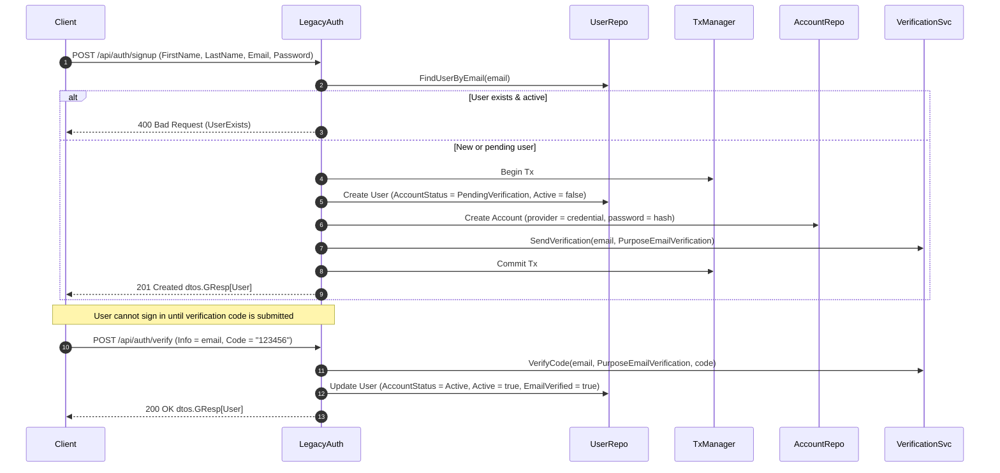
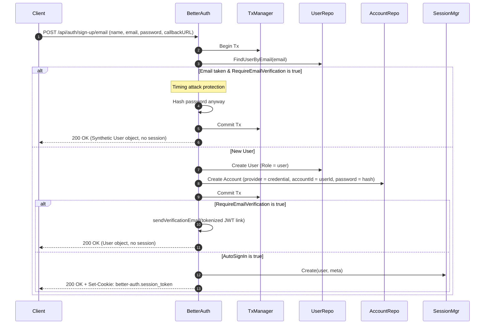
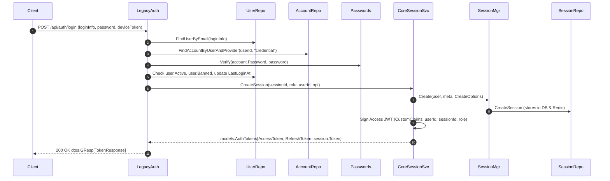
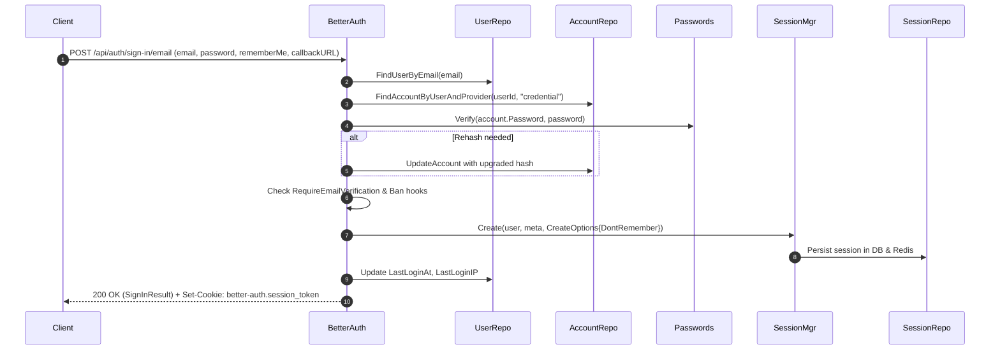

# Session Management & Dual Auth Flows: Architecture & Comparison

This document explains the architecture, mechanics, and relationships between:
1. `src/app/services/session/manager.go` (the Better-Auth core session manager)
2. `src/app/core/session/session.service.go` (the legacy GoAuth JWT session service)
3. The two authentication flows: Legacy (`src/app/core/auth`) vs. Better-Auth (`src/app/services/auth`)

---

## 1. Executive Summary

- **`src/app/services/session/manager.go`** is the canonical, specification-compliant **Better-Auth session engine**. It manages stateful, opaque session tokens stored in the database and/or secondary cache (Redis, in-memory, etc.) with sliding window expiration.
- **`src/app/core/session/session.service.go`** is **not** a competing implementation; it is a **facade/adapter that wraps `session.Manager`**. It translates stateful Better-Auth sessions into the legacy GoAuth dual-token model: an ephemeral signed JWT access token (`typ: "access"`) combined with the session's opaque token acting as the refresh token.
- **The two auth flows** (`app/core/auth` and `app/services/auth`) serve two distinct API paradigms (custom GoAuth REST API with `GResp` envelopes and JWTs vs. official Better-Auth TypeScript client specification). Under the hood, **both flows converge onto the exact same database records, the same password security system, and the same `session.Manager`**.

```
┌─────────────────────────────────────────────────────────────────────────────────┐
│                                 HTTP Clients                                    │
│   ┌───────────────────────────────┐     ┌───────────────────────────────────┐   │
│   │  Legacy Clients / Mobile Apps │     │   Modern / Better-Auth TS Client  │   │
│   │   (JWT Access + Refresh Tok)  │     │       (Opaque Cookie / Bearer)    │   │
│   └──────────────┬────────────────┘     └─────────────────┬─────────────────┘   │
└──────────────────┼────────────────────────────────────────┼─────────────────────┘
                   │                                        │                      
                   ▼                                        ▼                      
┌──────────────────────────────────────┐  ┌───────────────────────────────────────┐
│     Legacy Flow (app/core/auth)      │  │   Better-Auth Flow (app/services/auth)│
│  - POST /api/auth/signup             │  │  - POST /api/auth/sign-up/email       │
│  - POST /api/auth/login              │  │  - POST /api/auth/sign-in/email       │
│  - POST /api/auth/refresh            │  │  - GET  /api/auth/get-session         │
│  - Returns dtos.GResp[TokenResponse] │  │  - Returns raw better-auth DTOs       │
└──────────────────┬───────────────────┘  └─────────────────┬─────────────────────┘
                   │                                        │                      
                   ▼                                        │                      
┌──────────────────────────────────────┐                    │                      
│    core/session/session.service.go   │                    │                      
│  - Signs JWT Access Token            │                    │                      
│  - Handles token blacklisting        │                    │                      
│  - Reissues session with org roles   │                    │                      
└──────────────────┬───────────────────┘                    │                      
                   │ (delegates session lifecycle)          │                      
                   ▼                                        ▼                      
┌─────────────────────────────────────────────────────────────────────────────────┐
│                     src/app/services/session/manager.go                         │
│  - Generates opaque tokens (idgen.GenerateToken())                              │
│  - Dual DB + Secondary Storage (Redis/Keyv) caching                             │
│  - Sliding expiration (UpdateAge / ExpiresIn)                                   │
│  - Active sessions index ("active-sessions-<userId>")                           │
│  - Hook triggers (BeforeSessionCreate, SessionRevoked)                          │
└──────────────────────────────────┬──────────────────────────────────────────────┘
                                   │
                                   ▼
        ┌─────────────────────────────────────────────────────┐
        │  Shared Database & Storage Layer (GORM / Memory)    │
        │  - user table        - session table                │
        │  - account table     - secondary cache store        │
        └─────────────────────────────────────────────────────┘
```

---

## 2. How `session/manager.go` Works

`src/app/services/session/manager.go` implements Better-Auth's reference session lifecycle:

### A. Core Architecture
- **Token Format:** Cryptographically secure random opaque token generated via `idgen.GenerateToken()`.
- **Database & Cache Topology:**
  - Persists sessions in the database table `models.Session` via `repo_interfaces.ISessionRepo`.
  - Optionally caches session snapshots directly in `sec_storage.SecondaryStorage` (Redis, Keyv, etc.) under key `<token>`.
  - Supports cache-only mode (when `StoreInDatabase() == false`) or DB-backed mode with read-through cache.
- **Active Session Indexing:**
  - Maintains an active session index per user in secondary storage: `active-sessions-<userId>`.
  - Contains a JSON array of `{ token, expiresAt }` sorted by expiration.
  - Automatically pruned when sessions expire or are untracked. Enables `ListSessions` and `DeleteUserSessions` even when sessions are stored purely in memory/cache.

### B. Lifecycle Operations
1. **`Create(ctx, user, meta, opt)`**:
   - Computes expiration time based on `config.Session.ExpiresIn` (or fixed 24h if `opt.DontRemember == true`).
   - Generates an opaque token and unique session ID.
   - Executes lifecycle hook `hooks.TriggerBeforeSessionCreate(...)` (plugins can abort session creation here).
   - Writes to the database (if DB storage enabled).
   - Caches `dtos.SessionWithUser` in secondary storage with TTL matching session expiry.
   - Updates `active-sessions-<userId>`.
2. **`Get(ctx, tok)`**:
   - Checks secondary storage first for low-latency retrieval.
   - If not found or secondary storage is disabled, reads from the database.
   - If expired, deletes immediately and returns `nil`.
   - On DB cache hit, back-populates secondary storage.
   - Validates that legacy 64-hex refresh hashes are never accepted as cookie tokens.
3. **`ShouldRefresh(sw, dontRemember)` & `Refresh(ctx, sw)`**:
   - Implements **sliding expiration**: if `UpdateAge` has passed since the session was last refreshed (and `dontRemember == false` and `DisableSessionRefresh == false`), the session is refreshed.
   - `Refresh` pushes `ExpiresAt` forward to `now + config.Session.ExpiresIn` in both the DB and secondary cache.
4. **`RotateToken(ctx, sw)`**:
   - Generates a new opaque token for the existing session ID.
   - Invalidate the old token key in cache, updates the DB record, and sets the new token in cache.
5. **`Delete(ctx, tok)` & `DeleteUserSessions(ctx, userID)`**:
   - Deletes the session from cache and DB.
   - Triggers `hooks.TriggerSessionRevoked(ctx, tok)`.
6. **`RefreshUser(ctx, user)`**:
   - When user profile attributes change (e.g., name, avatar, role), iterates through `active-sessions-<userId>` in cache and updates the embedded `User` snapshot so active sessions reflect the changes without requiring DB lookups.

---

## 3. How `core/session/session.service.go` Works

`src/app/core/session/session.service.go` implements `serv_interfaces.LegSessionService` and represents the legacy GoAuth session paradigm.

### A. Role as an Adapter
`core/session/session.service.go` **does not maintain an independent session storage table**. Instead, it holds a reference to `mgr *sessionsvc.Manager`:
```go
type Service struct {
    SessionRepo repo_interfaces.ISessionRepo
    users       repo_interfaces.IUserRepo
    mgr         *sessionsvc.Manager
    sConf       config.SessionGoAuth
    sStore      sec_storage.SecondaryStorage
    Hooks       plugins.HookRegistry
}
```

### B. The Dual-Token Model
Legacy GoAuth was designed around traditional JWT Access Tokens + Refresh Tokens:
- **Access Token:** Short-lived stateless JWT signed with `AccessSecret`. It encodes claims: `userID`, `sessionID`, `role`, `activeOrgID`, `activeOrgRole`, and `typ: "access"`.
- **Refresh Token:** Instead of creating a separate refresh token database table, it uses the Better-Auth session's **opaque token** (`models.Session.Token`) as the refresh token!

### C. Specific Responsibilities
1. **`CreateSession(ctx, sessionId, role, userId, opt)`**:
   - Calls `aus.mgr.Create(...)` to create a standard Better-Auth session record.
   - Reads the resulting session record and calls `aus.tokens(s, role)` to sign a new JWT Access Token.
   - Returns `models.AuthTokens{ AccessToken: "<jwt>", RefreshToken: "<session.Token>" }`.
2. **`FindByRefreshToken(ctx, refreshToken)`**:
   - Delegates directly to `aus.mgr.Get(ctx, refreshToken)`.
3. **`RefreshTokens(ctx, s, role)`**:
   - Calls `aus.mgr.ShouldRefresh(...)` and `aus.mgr.Refresh(...)` to slide session expiry.
   - If `RotatesRefreshToken` is configured, calls `aus.mgr.RotateToken(...)` to issue a fresh opaque refresh token.
   - Signs a fresh Access JWT and returns the updated `models.AuthTokens`.
4. **`BlacklistSession(ctx, sessionId)`**:
   - Because Access JWTs are stateless, revoking a session would ordinarily leave the Access JWT valid until its TTL expires.
   - To fix this, `BlacklistSession` writes `blacklist:<sessionId>` to secondary storage with TTL matching the access token's remaining lifetime.
5. **`DeleteSession` & `DeleteAllUserSessions`**:
   - Calls `aus.mgr.Delete` / `aus.mgr.DeleteUserSessions` and blacklists the corresponding session IDs.

---

## 4. Detailed Comparison: `session/manager.go` vs `core/session/session.service.go`

### Comparison Table

| Attribute | `src/app/services/session/manager.go` | `src/app/core/session/session.service.go` |
|---|---|---|
| **Architectural Role** | Core Better-Auth session engine | Legacy JWT facade / transport adapter |
| **Primary Token Model** | Single opaque token (stored in signed cookie or Authorization header) | Dual tokens: Signed JWT Access Token + Opaque Refresh Token |
| **Token Representation** | Random string (`idgen.GenerateToken()`) | JWT string (`typ: "access"`) + session token string |
| **Verification Method** | Stateful lookup in Cache/DB via `manager.Get(token)` | Stateless cryptographic JWT verification via `ValidateAccessToken` (+ blacklist check) |
| **Sliding Expiry** | Native via `ShouldRefresh` and `Refresh` | Calls `manager.ShouldRefresh` and `manager.Refresh` |
| **Token Rotation** | `RotateToken` generates a new token for the session | Calls `manager.RotateToken` if configured, issues new JWT |
| **Revocation Handling** | Deletes DB row and cache key (immediate revocation) | Calls `manager.Delete` + writes `blacklist:<sessionId>` to secondary storage |
| **Return Data Types** | `*dtos.SessionWithUser`, `[]dtos.BetterAuthSession` | `*models.AuthTokens`, `*models.Session` |
| **Direct Consumers** | `app/services/auth`, Huma adapter resolver, `core/session/session.service.go` | `app/core/auth`, `app/core/session` handlers, `app/core/profile` |

### How They Are Similar
1. **Underlying Storage Entity:** Both operate on the same database table (`session` / `models.Session`) and secondary cache store.
2. **Lifecycle Delegations:** `core/session` does not reimplement session creation, sliding expiration, or session updating; it directly delegates these to `session.Manager`.
3. **Single Source of Truth:** A session created through `core/session/session.service.go` can be retrieved, updated, and revoked by `session/manager.go`, and vice-versa.
4. **Shared Hooks:** Both invoke standard lifecycle hooks like `TriggerBeforeSessionCreate` and `TriggerSessionRevoked`.

### How They Are Different
1. **Target Transport:** `session/manager.go` is designed for stateful cookie/bearer transports matching Better-Auth. `core/session/session.service.go` is designed for clients that expect an OAuth/OIDC-style access token JWT + refresh token.
2. **Blacklisting:** `session/manager.go` has no concept of JWT blacklisting because opaque session tokens are verified against storage on every request. `core/session` introduces blacklisting specifically to invalidate stateless JWTs before they expire.
3. **Dependency Direction:** `core/session` depends on `services/session` (`mgr *sessionsvc.Manager`), while `services/session` has zero knowledge of `core/session` or JWTs.

### Whether They Can Be Merged
- **Can they be combined into a single file?**
  Yes, but **they should NOT be merged into a single struct**.
  - **Single Responsibility Principle:** `session.Manager` is a pure session state manager matching Better-Auth's specification. Polluting it with JWT signing keys, access token expiration config, and blacklist keys would compromise modularity.
  - **Better-Auth Plugin Alignment:** In the Better-Auth ecosystem, JWT support is implemented as a **JWT Plugin** (`bearer` or `jwt` plugin).
- **The Ideal Path Forward:**
  - `core/session/session.service.go` can eventually be refactored into the official **JWT / Bearer Plugin** for GoAuth.
  - That plugin accepts `session.Manager` as a dependency and exposes endpoints to issue and refresh JWTs for clients (like mobile apps) that cannot use HTTP-only cookies.
  - If/when the legacy endpoints in `src/app/core/` are fully deprecated, `core/session/session.service.go` can either be removed or retained purely as a backward-compatibility shim.

---

## 5. The Two Authentication Flows: Legacy vs Better-Auth

The codebase currently contains two parallel authentication layers:
1. **Legacy Flow:** Located in `src/app/core/auth/` (registered in `src/app/core/setup-routes.go`)
2. **Modern Flow:** Located in `src/app/services/auth/` (registered in `src/app/adapters/huma/routes.go`)

### Flow Architecture Comparison

| Feature | Legacy Auth (`src/app/core/auth`) | Modern Auth (`src/app/services/auth`) |
|---|---|---|
| **API Endpoints** | `/signup`, `/verify`, `/login`, `/refresh`, `/logout`, `/forgot_password`, `/reset_password` | `/sign-up/email`, `/sign-in/email`, `/sign-out`, `/get-session`, `/verify-email`, `/change-email`, `/request-password-reset`, `/reset-password` |
| **Response Wrapper** | Wrapped in `dtos.GResp[T]` (`{ body, status, error, ... }`) | Direct JSON objects matching `@better-auth/client` |
| **Registration Architecture** | **Two-stage verification:** User created with `AccountStatus = PendingVerification`; must submit 6-digit code via `/verify` before login | **Single-stage / flexible:** User + Account created in single Tx. Verification email link can be required or optional; auto-login supported |
| **Timing Attack Mitigation** | Exposes whether email exists immediately on signup | Duplicate sign-ups return a synthetic success response with fake user when verification is required |
| **Password Storage** | Created in `models.Account` with provider `credential` | Created in `models.Account` with provider `credential`, accountId = userId |
| **Password Hashing** | Uses `authcrypto.Passwords` (bcrypt or configured hasher) | Uses `authcrypto.Passwords` (scrypt in compat mode, bcrypt, argon2) with auto-rehash support |
| **Login Response** | Returns `TokenResponse` with `AccessToken` (JWT) and `RefreshToken` | Sets signed HTTP-only cookie and returns `SignInResult` with user, session, and redirect URL |
| **Session Refresh** | Explicit POST to `/refresh` with `{ refreshToken }` | Implicit sliding refresh on GET `/get-session` or via session middleware |
| **User Status Check** | Checks `AccountStatus == Active` and `Active != false` and `Banned` | Checks `EmailVerified` (if required) and `Banned` (via hooks) |
| **Client Target** | Custom frontend clients, mobile apps | Better-Auth TypeScript client (`@better-auth/client`), React, Vue, Next.js |

---

### Step-by-Step Flow Breakdown

#### A. Registration & Verification Flow

##### 1. Legacy Flow (`src/app/core/auth/auth.service.go:RegisterWithEmail`)


##### 2. Modern Flow (`src/app/services/auth/sign.go:SignUpEmail`)


---

#### B. Login & Session Authentication Flow

##### 1. Legacy Flow (`src/app/core/auth/auth.service.go:Login`)


##### 2. Modern Flow (`src/app/services/auth/sign.go:SignInEmail`)


---

## 6. How the Two Flows Coexist and Merge

Although the two auth services expose different HTTP contracts, they are **fully unified at the data and core logic layers**:

### 1. Shared Database Tables
- Both flows read and write to the exact same tables: `user`, `account`, `session`, and `verification`.
- The `models.User` struct incorporates both Better-Auth fields (`Name`, `Email`, `EmailVerified`, `Image`) and legacy GoAuth fields (`FirstName`, `LastName`, `AccountStatus`, `Active`, `Role`).
- The `models.Session` record created during a legacy login has the exact same structure as one created during a Better-Auth login.

### 2. Shared Session Manager
- `src/app/core/session/session.service.go` calls `src/app/services/session/manager.go`.
- Therefore, when a user logs in via the legacy `/api/auth/login` endpoint:
  1. A Better-Auth session is created via `session.Manager`.
  2. The session token is returned as the legacy `refreshToken`.
  3. That session immediately becomes visible to Better-Auth endpoints (e.g., `GET /api/auth/list-sessions` will display it).
  4. Revoking the session via Better-Auth (`POST /api/auth/revoke-session`) will invalidate the legacy refresh token!

### 3. Unified Middleware Resolution
In `goauth.go`:
```go
mdlWare.WithSessions(humaadapter.NewSessionClaims(sessionMgr, cookieMgr, repos))
```
The authentication middleware can authenticate a request regardless of which client sent it:
- If the client sends an `Authorization: Bearer <JWT>`, the middleware verifies the JWT signature and checks `RevocationStore`.
- If the client sends a Better-Auth cookie (`better-auth.session_token`) or an opaque `Authorization: Bearer <opaqueToken>`, the middleware resolves the session using `sessionMgr.Get(token)`.

### 4. Password Compatibility & Automatic Upgrade
Both flows use `authcrypto.Passwords`. When a legacy user created with bcrypt logs in via Better-Auth, `passwords.Verify` recognizes bcrypt, verifies it, and transparently upgrades the stored hash to scrypt or argon2 if rehashing is enabled.

---

## 7. Migration & Unification Roadmap

To complete the unification of both flows per the project roadmap (`_docs/04-plan/02-steps.md`):

1. **Step 1: DTO Unification (Step 7 Remainder)**
   - Merge `dtos.UserResponse` and `dtos.SessionData` into `dtos.BetterAuthUser` and `dtos.BetterAuthSession`.
   - Update legacy handlers to serialize camelCase properties by default.
2. **Step 2: Convert Legacy Auth Handler to a Thin Adapter**
   - Replace the business logic inside `src/app/core/auth/auth.service.go` with calls to `src/app/services/auth/Service`.
   - The legacy service will only be responsible for mapping legacy request inputs and wrapping results in `dtos.GResp`.
3. **Step 3: Extract JWT Handling to a Plugin**
   - Move `core/session/session.service.go` into a dedicated `plugins/bearer_jwt` plugin.
   - This keeps `app/services/session/manager.go` clean and spec-compliant while providing first-class JWT token support for mobile and API client use cases.
