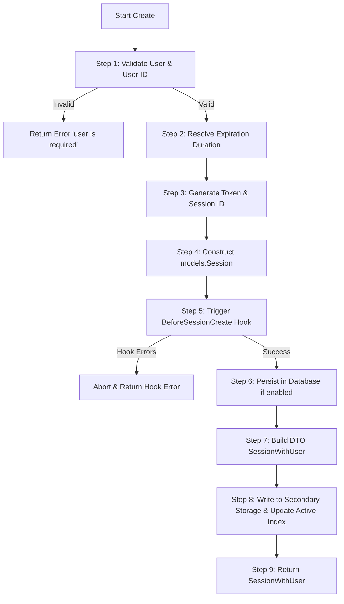
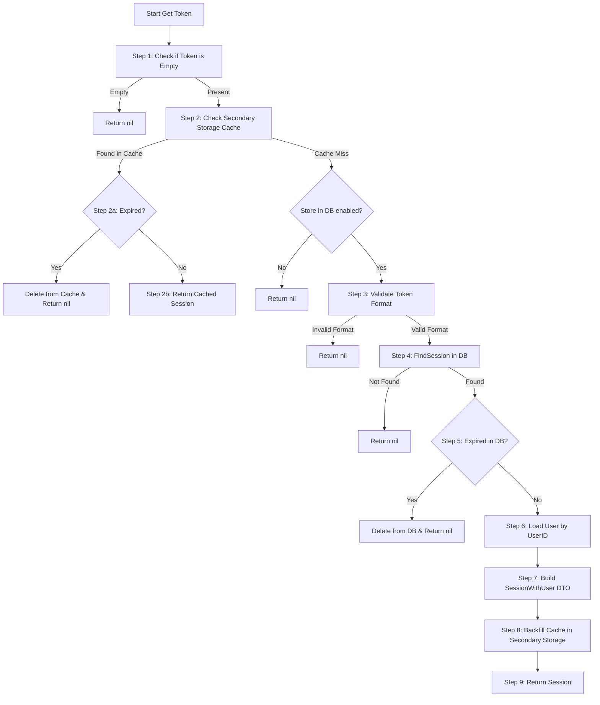

# Session Manager Step-by-Step Architecture Guide

This document provides a detailed, step-by-step breakdown of how session management works in `goauth`, focusing on the core implementation in [`src/app/services/session/manager.go`](file:///home/k/Documents/7proj/better-go-auth/goauth/src/app/services/session/manager.go) and its utility functions in [`src/app/services/session/manager-util.go`](file:///home/k/Documents/7proj/better-go-auth/goauth/src/app/services/session/manager-util.go).

---

## 1. Overview & Core Concepts

The `session.Manager` struct is the central engine for creating, retrieving, updating, refreshing, and revoking user sessions.

### Key Architectural Pillars:
1. **Opaque Tokens:**
   - Every session is identified by a cryptographically random 32-character alphanumeric token (`idgen.GenerateToken()`).
   - Tokens provide ~190 bits of entropy and are stored in plaintext in the database/cache for $O(1)$ indexed lookups.
2. **Dual-Store Architecture (Database + Secondary Cache):**
   - **Database (`ISessionRepo`):** Primary persistence store (GORM, SQLite, PostgreSQL, MySQL).
   - **Secondary Storage (`SecondaryStorage`):** Fast key-value cache (e.g., Redis, Keyv, in-memory) stored under key `<token> -> {"session", "user"}`.
   - Supports DB-backed mode with read-through cache, or cache-only mode when `StoreInDatabase() == false`.
3. **Active Sessions Index:**
   - When secondary storage is enabled, the manager maintains an index of all active sessions for each user under the key `active-sessions-<userId>`.
   - This enables features like listing all sessions or revoking all sessions for a user, even in cache-only configurations without database queries.
4. **Sliding Expiration Window:**
   - Rather than updating the database on every HTTP request, Better-Auth enforces a sliding window: session expiration is only extended once `UpdateAge` has passed since the session was last refreshed.

---

## 2. Step-by-Step Logic of Core Functions

### A. `Create` (Starting a New Session)

Function signature:
```go
func (mgr *Manager) Create(ctx context.Context, user *models.User, meta Meta, opt CreateOptions) (*dtos.SessionWithUser, error)
```



#### Detailed Steps:
1. **Validate Input:**
   - Checks `if user == nil || user.ID == ""`.
   - If invalid, aborts immediately and returns `errors.New("sessions: user is required")`.
2. **Resolve Expiration Duration:**
   - Default: `mgr.conf.ExpiresIn` (typically 7 days).
   - If `opt.DontRemember` is true (e.g. `rememberMe=false` during sign-in), overrides to a fixed 24-hour lifetime (`dontRememberLifetime = 24 * time.Hour`).
   - If caller supplied an explicit `opt.ExpiresIn > 0`, that value takes precedence.
3. **Generate Token & Session ID:**
   - Generates a high-entropy 32-character random string: `tok := idgen.GenerateToken()`.
   - Uses `opt.ID` if provided by the caller (useful for legacy callers migrating existing session IDs), otherwise generates a new unique ID: `models.NewID()`.
4. **Construct `models.Session` Model:**
   - Assigns timestamps: `CreatedAt = now`, `UpdatedAt = now`, `ExpiresAt = now.Add(expiresIn)`.
   - Stores request metadata (`IPAddress`, `UserAgent`).
   - Stores optional plugin attributes (`ImpersonatedBy` for admin plugin, `ActiveOrganizationID` and `ActiveOrganizationRole` for organization plugin, and `DeviceToken`).
5. **Execute Lifecycle Hooks:**
   - If `mgr.hooks != nil`, constructs `CustomClaims` and calls `mgr.hooks.TriggerBeforeSessionCreate(ctx, s, &claims)`.
   - Allows plugins (such as the admin plugin checking whether the user is banned) to reject session creation before database writes occur.
6. **Persist to Database:**
   - If `mgr.storeInDB()` is true, calls `mgr.sessionsRepo.CreateSession(ctx, s)`.
7. **Construct Response DTO:**
   - Packages the session and user into `dtos.SessionWithUser{ Session: dtos.SessionFromModel(s), User: dtos.UserFromModel(user) }`.
8. **Cache & Track Active Sessions:**
   - If secondary storage is configured (`mgr.secStore != nil`):
     - Serializes `SessionWithUser` to JSON and writes it under key `<tok>` with TTL matching remaining expiration (`mgr.cache`).
     - Calls `mgr.trackActive(ctx, user.ID, tok, s.ExpiresAt)` to append the token to the user's `active-sessions-<userId>` list.
9. **Return Result:**
   - Returns the created `*dtos.SessionWithUser`.

---

### B. `Get` (Retrieving a Live Session)

Function signature:
```go
func (mgr *Manager) Get(ctx context.Context, tok string) (*dtos.SessionWithUser, error)
```



#### Detailed Steps:
1. **Empty Check:**
   - `if tok == ""` returns `nil, nil` immediately.
2. **Secondary Storage Cache Check:**
   - If secondary storage is enabled, attempts to read from cache via `mgr.fromStore(ctx, tok)`.
   - **Step 2a:** If found but `mgr.expired(sSec)` is true, revokes the session via `mgr.Delete(ctx, tok)` and returns `nil`.
   - **Step 2b:** If found and active, returns `sSec` immediately (zero database queries).
   - **Step 2c:** If cache missed and `!mgr.storeInDB()`, returns `nil` since the session cannot exist in the DB.
3. **Format Validation:**
   - Validates `idgen.IsToken(tok)` (must be 32 alphanumeric chars).
   - Rejects legacy 64-hex refresh hashes so that an old refresh token hash can never be replayed as a cookie session token.
4. **Database Lookup:**
   - Calls `mgr.sessionsRepo.FindSession(ctx, tok)` (`WHERE token = ?`).
   - If not found, returns `nil, nil`.
5. **Expiration Validation:**
   - Checks `if !s.ExpiresAt.After(mgr.now())`.
   - If expired, deletes the dead row via `mgr.Delete(ctx, tok)` and returns `nil`.
6. **User Lookup:**
   - Calls `mgr.usersRepo.FindUserByID(ctx, s.UserID)`.
   - If the user was deleted from the database, returns `nil, nil`.
7. **Construct DTO:**
   - Converts the models into `dtos.SessionWithUser`.
8. **Cache Backfill:**
   - Backfills secondary storage (`mgr.cache(ctx, sw)`) so subsequent requests are served entirely from cache.
9. **Return Result:**
   - Returns the active `*dtos.SessionWithUser`.

---

### C. `ShouldRefresh` and `Refresh` (Sliding Expiry)

#### `ShouldRefresh`
```go
func (mgr *Manager) ShouldRefresh(sw *dtos.SessionWithUser, dontRemember bool) bool
```
1. **Guard Checks:**
   - If session is nil, `dontRemember` is true, or `DisableSessionRefresh` is configured, returns `false`.
2. **Compute Threshold:**
   - Calculates the target refresh date:
     $$\text{dueAt} = \text{ExpiresAt} - \text{ExpiresIn} + \text{UpdateAge}$$
   - *Example:* If a session lasts 7 days (`ExpiresIn = 7d`) and updates every 1 day (`UpdateAge = 1d`), `dueAt` is exactly 1 day after the session was created or last refreshed.
3. **Evaluate:**
   - Returns true if current time $\ge \text{dueAt}$.

#### `Refresh`
```go
func (mgr *Manager) Refresh(ctx context.Context, sw *dtos.SessionWithUser) (*dtos.SessionWithUser, error)
```
1. **Calculate New Expiry:**
   - Computes `now := mgr.now().UTC()` and `expiresAt := now.Add(mgr.conf.ExpiresIn)`.
2. **Update Database:**
   - If `mgr.storeInDB()`, updates the row in the DB: `ExpiresAt = expiresAt` and `UpdatedAt = now`.
3. **Update Local Copy:**
   - Creates a shallow copy of the DTO and updates `ExpiresAt` and `UpdatedAt`.
4. **Update Cache & Active Index:**
   - If secondary storage is enabled, updates the cached JSON in cache via `mgr.cache` and calls `mgr.trackActive` with the updated expiration date.
5. **Return:**
   - Returns the refreshed session DTO.

---

### D. `RotateToken` (Token Rotation)

Function signature:
```go
func (mgr *Manager) RotateToken(ctx context.Context, sw *dtos.SessionWithUser) (*dtos.SessionWithUser, error)
```

1. **Generate New Token:**
   - Captures `oldTok := sw.Session.Token`.
   - Generates `newTok := idgen.GenerateToken()`.
2. **Update Storage:**
   - If storing in DB: executes `mgr.sessionsRepo.UpdateSession(ctx, sw.Session.ID, map[string]interface{}{"Token": newTok, "UpdatedAt": now})`.
   - If cache-only: verifies `oldTok` exists in cache and updates the in-memory token.
3. **Cache Invalidation:**
   - Deletes `oldTok` from secondary storage (`mgr.secStore.Delete(ctx, oldTok)`).
   - Untracks `oldTok` from `active-sessions-<userId>` list (`mgr.untrackActive`).
4. **Cache New Token:**
   - Caches `newTok` under its new key and registers it in `active-sessions-<userId>`.
5. **Return:**
   - Returns the updated session with the new token.

---

### E. `Update` (Mutating Session Fields)

Function signature:
```go
func (mgr *Manager) Update(ctx context.Context, sw *dtos.SessionWithUser, data map[string]any) (*dtos.SessionWithUser, error)
```

1. **Prepare Fields:**
   - Copies caller fields into a new map and appends `UpdatedAt = now`.
2. **Apply Updates:**
   - **DB Mode:** Calls `mgr.sessionsRepo.UpdateSession(ctx, sw.Session.ID, fields)`.
   - **Cache-Only Mode:** Verifies session exists, then calls `setSessionFields(&out.Session, data)` which uses Go reflection to safely set struct fields by name.
3. **Sync Cache:**
   - Writes the updated session snapshot back into secondary storage (`mgr.cache`).
4. **Return:**
   - Returns the updated session DTO.

---

### F. `Delete` & `DeleteUserSessions` (Revocation)

#### `Delete` (Single Token)
1. **Cache Eviction:**
   - Reads session user ID (if cached), deletes key `tok` from secondary storage, and untracks it from `active-sessions-<userId>`.
2. **Database Deletion:**
   - Calls `mgr.sessionsRepo.DeleteSession(ctx, tok)` unless `PreserveSessionInDatabase` is set to true.
3. **Lifecycle Hooks:**
   - Fires `mgr.hooks.TriggerSessionRevoked(ctx, tok)` (informing plugins of revocation).

#### `DeleteUserSessions` (All Sessions for User)
1. **Secondary Storage Cleanup:**
   - Iterates through all entries in `active-sessions-<userId>`, deletes each individual session key `<token>`, and deletes the index key itself (`active-sessions-<userId>`).
2. **Database Cleanup:**
   - Calls `mgr.sessionsRepo.DeleteUserSessions(ctx, userID)`.

---

### G. `RefreshUser` (Propagating User Changes)

Function signature:
```go
func (mgr *Manager) RefreshUser(ctx context.Context, user *models.User)
```
1. **Guard Check:**
   - Returns immediately if `secStore == nil` or `user == nil`.
2. **Iterate & Sync:**
   - Reads all tokens from `active-sessions-<userId>`.
   - Loads each cached session, swaps `sw.User = dtos.UserFromModel(user)`, and re-saves it in secondary storage.
   - *Result:* When a user updates their display name or profile picture, all open sessions immediately reflect the change without re-signing tokens or modifying database session rows.

---

### H. `List` (Enumerating User Sessions)

Function signature:
```go
func (mgr *Manager) List(ctx context.Context, userID string) ([]dtos.BetterAuthSession, error)
```
1. **Cache-Only Mode:**
   - Reads `active-sessions-<userId>` list from secondary storage.
   - For each token, reads from cache and appends if `ExpiresAt > now`.
2. **DB Mode:**
   - Calls `mgr.sessionsRepo.ListSessions(ctx, userID)`.
   - Filters out any legacy non-token entries (`idgen.IsToken(row.Token)`) and expired sessions.
3. **Return:**
   - Returns list of `[]dtos.BetterAuthSession`.

---

## 3. Function & Feature Matrix

| Function | Primary Storage Action | Secondary Storage Action | Hooks Triggered |
|---|---|---|---|
| `Create` | `CreateSession(ctx, s)` | `cache(ctx, sw)`, `trackActive(...)` | `BeforeSessionCreate` |
| `Get` | `FindSession(ctx, tok)` | `fromStore(ctx, tok)`, backfills `cache` | None |
| `ShouldRefresh` | Read in-memory timestamps | Read in-memory timestamps | None |
| `Refresh` | `UpdateSession(ExpiresAt, UpdatedAt)` | `cache(ctx, sw)`, `trackActive(...)` | None |
| `RotateToken` | `UpdateSession(Token, UpdatedAt)` | `Delete(oldTok)`, `cache(newTok)`, `untrack/track` | None |
| `Update` | `UpdateSession(fields)` | `cache(ctx, sw)` | None |
| `Delete` | `DeleteSession(tok)` | `Delete(tok)`, `untrackActive` | `SessionRevoked` |
| `DeleteUserSessions` | `DeleteUserSessions(userID)` | Deletes all tokens + `activeKey(userID)` | None |
| `RefreshUser` | None (no DB hit) | Rewrites user in all cached sessions | None |
| `List` | `ListSessions(userID)` | Reads `activeList(userID)` if DB disabled | None |
