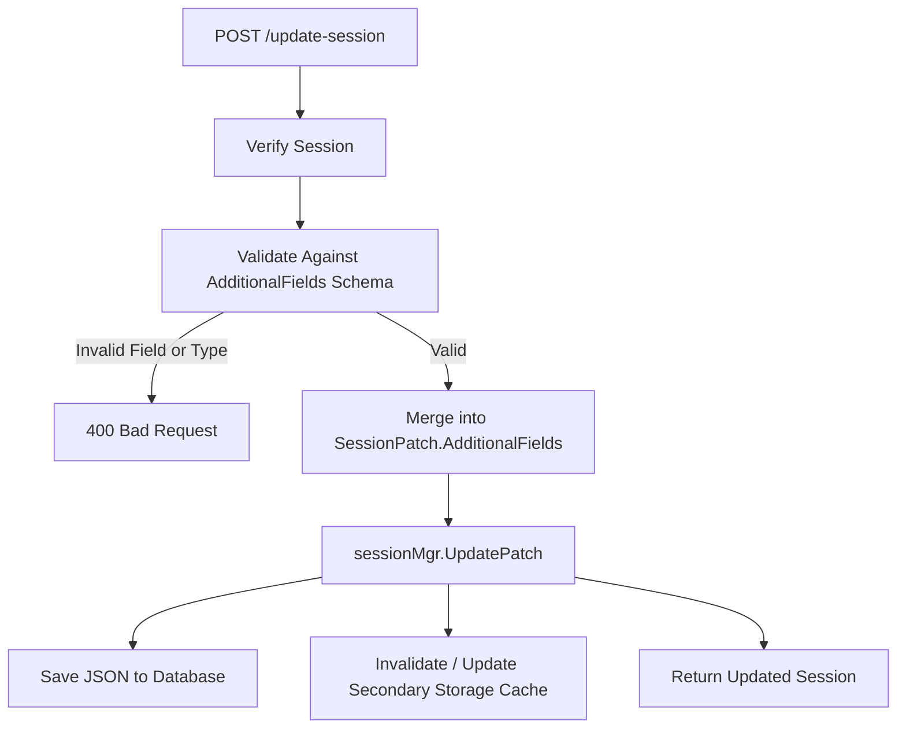

# Generic Session.AdditionalFields Implementation Plan

> **Topic:** Architectural Design & Implementation Plan for Generic `Session.AdditionalFields`  
> **Target:** `better-go-auth/goauth`  
> **Status:** Draft / Planned  
> **Reference:** Better Auth Core Specification (`session.additionalFields`)

---

## 1. Executive Summary & Objective

In Better Auth, applications can configure arbitrary `additionalFields` on sessions (e.g. `deviceId`, `ipCountry`, `tenantId`, `loginProvider`, `riskScore`, etc.). Currently in GoAuth:
- Only a fixed set of hardcoded device fields (`DeviceToken`, `DeviceID`, `DeviceName`, `DeviceType`, `ImpersonatedBy`, `ActiveOrganizationID`, `ActiveTeamID`) exist on `models.Session`.
- `POST /update-session` only allows mutating a predefined allowlist (`config.DefaultUpdatableSessionFields`).
- Dynamic session attributes cannot be persisted, validated, or surfaced in `/get-session`.

This document presents a comprehensive, production-grade architectural plan to implement generic `Session.AdditionalFields` with type-safe schema definitions, validation, JSON-serialized persistence, caching synchronization, and API integration.

---

## 2. Configuration Design

### 2.1 Field Definition Interface
Following Better Auth's schema model, `config.SessionGoAuth` will support an `AdditionalFields` registry:

```go
package config

// FieldType represents the supported primitive types for dynamic fields.
type FieldType string

const (
	FieldTypeString  FieldType = "string"
	FieldTypeNumber  FieldType = "number"
	FieldTypeBoolean FieldType = "boolean"
	FieldTypeDate    FieldType = "date"
)

// AdditionalFieldDefinition specifies the metadata and validation rules for a dynamic field.
type AdditionalFieldDefinition struct {
	Type        FieldType `json:"type" yaml:"type"`                     // string, number, boolean, date
	Required    bool      `json:"required,omitempty" yaml:"required"`   // whether field must be present
	Default     any       `json:"defaultValue,omitempty" yaml:"defaultValue"` // default value if omitted
	Returned    *bool     `json:"returned,omitempty" yaml:"returned"`   // whether returned in /get-session (default true)
	Input       *bool     `json:"input,omitempty" yaml:"input"`         // whether client can modify via /update-session (default true)
	Description string    `json:"description,omitempty" yaml:"description"`
}

// SessionGoAuth extensions
type SessionGoAuth struct {
	// ... existing fields ...
	AdditionalFields map[string]AdditionalFieldDefinition `json:"additionalFields,omitempty"`
}
```

---

## 3. Storage & Schema Architecture

### 3.1 Persistence Approaches Considered

| Approach | Pros | Cons | Recommendation |
| :--- | :--- | :--- | :--- |
| **A. JSON Column (`serializer:json`)** | • Works across PostgreSQL (`jsonb`), MySQL (`json`), and SQLite (`text`) without DDL migration overhead.<br>• Flexible, zero database lock time on field additions.<br>• Clean fallback and serialization. | Slightly higher serialization cost than native columns. | **Recommended** (Primary) |
| **B. Dynamic GORM AutoMigrate Columns** | • Native SQL types and column indexing. | • Schema divergence across environments.<br>• DB locks on live tables.<br>• Cross-database migration complexities. | Optional future optimization |

### 3.2 GORM & Bun Model Definition
In [`src/models/auth.session.go`](file:///home/k/Documents/7proj/better-go-auth/goauth/src/models/auth.session.go):

```go
type Session struct {
    // ... existing fields ...

    // AdditionalFields stores arbitrary dynamic session attributes
    AdditionalFields map[string]any `json:"additionalFields,omitempty" gorm:"serializer:json" bun:"additional_fields,type:jsonb"`
}
```

### 3.3 Session DTOs
In [`src/models/dtos/better_auth.go`](file:///home/k/Documents/7proj/better-go-auth/goauth/src/models/dtos/better_auth.go):

```go
type SessionData struct {
    // ... existing fields ...
    AdditionalFields map[string]any `json:"additionalFields,omitempty"`
}
```

In [`src/config/session-config.go`](file:///home/k/Documents/7proj/better-go-auth/goauth/src/config/session-config.go):

```go
type SessionPatch struct {
    // ... existing fields ...
    AdditionalFields map[string]any `json:"additionalFields,omitempty"`
}

func (sp SessionPatch) ToMap() map[string]any {
    m := map[string]any{}
    // ... existing assignments ...
    if sp.AdditionalFields != nil {
        m["AdditionalFields"] = sp.AdditionalFields
    }
    return m
}
```

---

## 4. Validation & Pipeline Processing

### 4.1 Validator Engine
Create a lightweight validator in `src/app/services/session/validator.go`:

```go
func ValidateAdditionalFields(
    input map[string]any,
    schema map[string]config.AdditionalFieldDefinition,
    isClientInput bool,
) (map[string]any, error) {
    clean := make(map[string]any)
    for fieldName, def := range schema {
        val, exists := input[fieldName]
        if !exists || val == nil {
            if def.Required {
                return nil, fmt.Errorf("field %q is required", fieldName)
            }
            if def.Default != nil {
                clean[fieldName] = def.Default
            }
            continue
        }
        if isClientInput && def.Input != nil && !*def.Input {
            return nil, fmt.Errorf("field %q cannot be modified by client", fieldName)
        }
        // Type validation
        if err := validateFieldType(fieldName, val, def.Type); err != nil {
            return nil, err
        }
        clean[fieldName] = val
    }
    return clean, nil
}
```

### 4.2 Lifecycle Integration



---

## 5. API Layer Mapping

### 5.1 `/update-session` Handler
In [`src/app/adapters/huma/session_routes.go`](file:///home/k/Documents/7proj/better-go-auth/goauth/src/app/adapters/huma/session_routes.go):
- Accept generic map or dynamic properties in the request body alongside standard device fields.
- Filter against `config.SessionGoAuth.AdditionalFields` where `def.Input == nil || *def.Input == true`.
- Construct `config.SessionPatch{ AdditionalFields: validatedFields }`.

### 5.2 `/get-session` Handler
In [`src/app/adapters/huma/session_routes.go`](file:///home/k/Documents/7proj/better-go-auth/goauth/src/app/adapters/huma/session_routes.go):
- When returning `GetSessionOutput.Body.Session`:
  - Filter out any fields where `def.Returned != nil && !*def.Returned`.
  - Expose `additionalFields` either in the nested `additionalFields` key or flattened into the root session JSON object according to the Better Auth specification mode.

---

## 6. Implementation Phasing & Milestones

### Phase 4.1: Model & Config Foundations
1. Add `AdditionalFields` map to `config.SessionGoAuth`.
2. Add `AdditionalFields map[string]any` to `models.Session` with `gorm:"serializer:json"`.
3. Add `AdditionalFields` to `dtos.SessionData` and `config.SessionPatch`.
4. Update `applyPatch` in `src/app/services/session/manager.go` to merge `patch.AdditionalFields`.

### Phase 4.2: Validation & Repository Layer
1. Implement `ValidateAdditionalFields` with type check helpers (`string`, `number`, `boolean`, `date`).
2. Verify SQLite, PostgreSQL, and MySQL serializations in `SessionRepo.UpdateSession`.
3. Ensure secondary storage (Memory and Redis) stores and retrieves `AdditionalFields` cleanly without loss of type information.

### Phase 4.3: Huma Adapters & Serialization
1. Update `UpdateSessionInput` to accept custom fields.
2. Hook `ValidateAdditionalFields` into the `UpdateSession` handler.
3. Update `GetSession` response serialization to include validated additional fields.

### Phase 4.4: Testing & Contract Verification
1. **Unit Tests**:
   - Validation test suite (`test_validation.go`): required checks, type mismatches, client input restrictions, default fallback values.
2. **Integration Tests**:
   - `src/tests/session`: Create session with dynamic attributes, update via `/update-session`, verify retrieval via `/get-session`.
   - Concurrency tests: verify safe parallel updates to additional fields.
3. **Cross-Compatibility**:
   - Verify Better Auth TypeScript client contracts with custom session attributes.

---

## 7. Migration & Backward Compatibility
- **Zero Breaking Changes**: Existing sessions without `additional_fields` default to `nil` or `{}`.
- **Table Alteration**: GORM and Bun will add the nullable `additional_fields` column automatically during `AutoMigrate`.
- **Existing Device Fields**: `DeviceToken`, `DeviceID`, `DeviceName`, and `DeviceType` continue to work natively as first-class fields, coexisting seamlessly with `AdditionalFields`.
