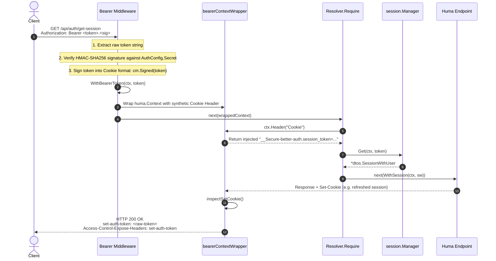
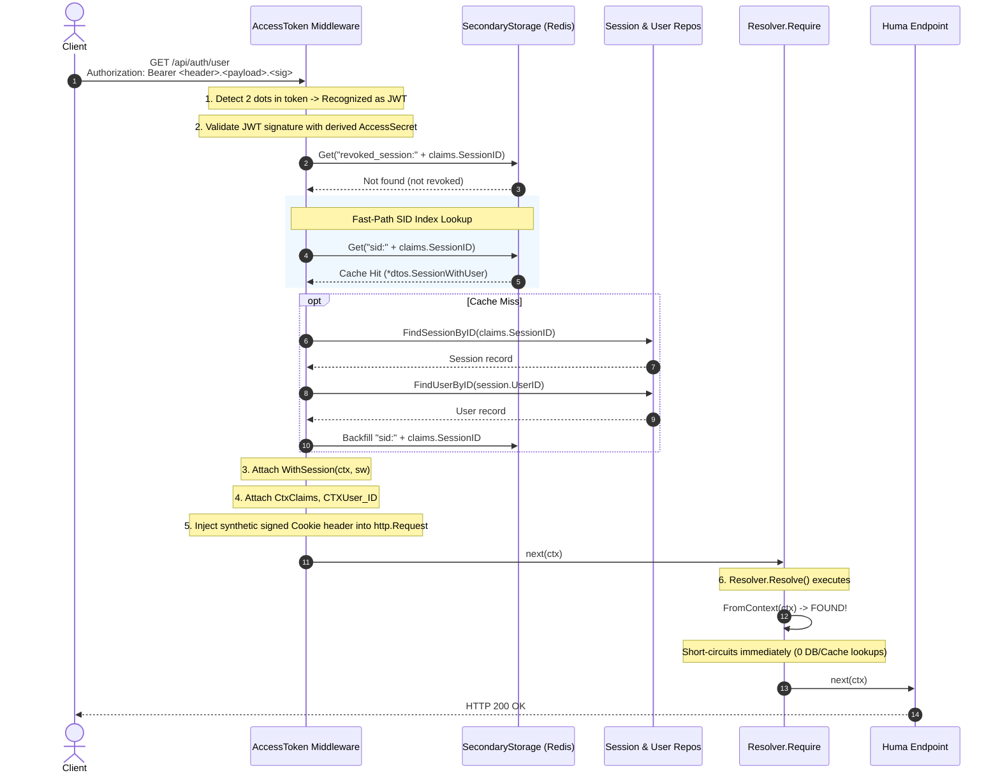

# Token Resolution and Middleware Flow in GoAuth

> **Reference Document:** Deep-dive architectural guide to token resolution, middleware chaining, and context propagation across core GoAuth, the `bearer` plugin, and the `access-token` plugin.  
> **Source Files Inspected:**  
> - Core Middleware & Resolver: [`src/app/adapters/huma/session_middleware.go`](file:///home/k/Documents/7proj/better-go-auth/goauth/src/app/adapters/huma/session_middleware.go), [`src/app/adapters/huma/routes.go`](file:///home/k/Documents/7proj/better-go-auth/goauth/src/app/adapters/huma/routes.go), [`src/app/adapters/huma/session_routes.go`](file:///home/k/Documents/7proj/better-go-auth/goauth/src/app/adapters/huma/session_routes.go)  
> - Cookie Manager: [`src/providers/cookies/cookies.go`](file:///home/k/Documents/7proj/better-go-auth/goauth/src/providers/cookies/cookies.go)  
> - Session Manager: [`src/app/services/session/manager.go`](file:///home/k/Documents/7proj/better-go-auth/goauth/src/app/services/session/manager.go)  
> - Bearer Plugin: [`src/plugins/bearer/bearer.plugin.go`](file:///home/k/Documents/7proj/better-go-auth/goauth/src/plugins/bearer/bearer.plugin.go)  
> - Access-Token Plugin: [`src/plugins/access-token/access_token.plugin.go`](file:///home/k/Documents/7proj/better-go-auth/goauth/src/plugins/access-token/access_token.plugin.go)  
> - Runtime Setup: [`goauth.go`](file:///home/k/Documents/7proj/better-go-auth/goauth/goauth.go)  

---

## 1. Architectural Overview

GoAuth supports three distinct token resolution pathways:
1. **Core Better Auth Session Flow (Cookie-based):** Uses signed HTTP-only cookies (`__Secure-better-auth.session_token`).
2. **Better Auth Bearer Plugin Flow (`plugins/bearer`):** Supports standard Better Auth HTTP `Authorization: Bearer <token>` or `Authorization: Bearer <token>.<signature>` headers by dynamically translating them into session cookies and responding with `set-auth-token` response headers.
3. **Legacy Access-Token Plugin Flow (`plugins/access-token`):** Supports stateless HMAC-SHA256 access JWTs alongside database-backed refresh/session tokens, caching session resolutions under an `sid:<session_id>` secondary storage index.

### High-Level Resolution Topology

```mermaid
flowchart TD
    Req[Incoming HTTP Request] --> GlobalMiddlewares[Global Huma Middlewares]

    subgraph Global Plugins Phase [Registered via api.UseMiddleware]
        GlobalMiddlewares --> AccessTokenMW{access-token Plugin Middleware}
        AccessTokenMW -- "Has Bearer <jwt> (3 parts)" --> AT_Verify[Verify JWT & Check Blacklist]
        AT_Verify --> AT_SIDCache{sid: Cache Hit?}
        AT_SIDCache -- Yes --> AT_Inject[Inject WithSession + CtxClaims + Cookie Header]
        AT_SIDCache -- No --> AT_DB[FindSessionByID & User -> Backfill sid:] --> AT_Inject
        AccessTokenMW -- Not a JWT / Skipped --> BearerMW{bearer Plugin Middleware}
        
        AT_Inject --> BearerMW
        BearerMW -- "Has Bearer <token>" --> B_Verify[Verify HMAC Signature & Extract Token]
        B_Verify --> B_Wrap[Wrap huma.Context with bearerContextWrapper & Inject Cookie Header]
        BearerMW -- No Bearer / Skipped --> RouteMW[Route Operation Middlewares]
        B_Wrap --> RouteMW
    end

    subgraph Route Execution Phase [Defined on Operation]
        RouteMW --> CoreResolver{Resolver.Require / Optional}
        CoreResolver -- "FromContext(ctx) already set?" --> FastExit[Short-circuit: Session Ready]
        CoreResolver -- "FromContext is nil" --> ReadCookie[Read & Verify Cookie Header]
        ReadCookie --> SessMgrGet[session.Manager.Get]
        SessMgrGet --> CacheLookup{SecondaryStorage Cache?}
        CacheLookup -- Hit --> SessAttach[Attach WithSession]
        CacheLookup -- Miss --> DBLookup[DB FindSession & FindUserByID] --> Backfill[Backfill SecondaryStorage] --> SessAttach
        FastExit --> EndpointHandler[Endpoint Handler / Business Logic]
        SessAttach --> EndpointHandler
    end

    subgraph Response Phase
        EndpointHandler --> AfterHooks[bearerContextWrapper.finalizeHeaders]
        AfterHooks -- Set-Cookie present --> SetAuthTokenHeader[Emit set-auth-token & CORS headers]
        AfterHooks -- No Set-Cookie --> ClientResp[HTTP Response to Client]
        SetAuthTokenHeader --> ClientResp
    end
```



---

## 2. Normal Flow: Core Better Auth Session Cookies

In standard Better Auth, authentication state is tracked via signed session cookies without client-side JWTs.

### Step 1: Client Issues Request with Cookie
The client browser sends:
```http
GET /api/auth/list-sessions HTTP/1.1
Host: api.example.com
Cookie: __Secure-better-auth.session_token=r7A9...32chars.3b9f...hmacSignature
```

### Step 2: Huma Route Middlewares Invoked
In [`src/app/adapters/huma/routes.go`](file:///home/k/Documents/7proj/better-go-auth/goauth/src/app/adapters/huma/routes.go#L55-L62), endpoints requiring authentication attach [`Resolver.Require()`](file:///home/k/Documents/7proj/better-go-auth/goauth/src/app/adapters/huma/session_middleware.go#L82-L85) or [`Resolver.Optional()`](file:///home/k/Documents/7proj/better-go-auth/goauth/src/app/adapters/huma/session_middleware.go#L68-L80).

### Step 3: [`Resolver.Resolve()`](file:///home/k/Documents/7proj/better-go-auth/goauth/src/app/adapters/huma/session_middleware.go#L51-L65) Execution
```go
func (r *Resolver) Resolve(ctx context.Context, cookieHeader string) (*dtos.SessionWithUser, error) {
    // 1. Check if an upstream middleware already set the session in context
    if sw, ok := FromContext(ctx); ok && sw != nil {
        return sw, nil
    }
    // 2. Read and verify the signed cookie
    tok, ok := r.cookies.SessionToken(cookieHeader)
    if !ok {
        // Fallback to Bearer context if populated
        if btok, bok := FromBearerContext(ctx); bok {
            tok, ok = btok, true
        }
    }
    if !ok {
        return nil, nil
    }
    // 3. Delegate session retrieval to session.Manager
    return r.mgr.Get(ctx, tok)
}
```

### Step 4: Token Signature Verification in [`Manager.ReadSigned()`](file:///home/k/Documents/7proj/better-go-auth/goauth/src/providers/cookies/cookies.go#L84-L95)
1. Parse cookie header looking for either `__Secure-better-auth.session_token` or `better-auth.session_token`.
2. Extract value: `base64(token).signature`.
3. Recompute HMAC-SHA256 over the base64-encoded token using `AuthConfig.Secret`.
4. Validate signature using constant-time comparison (`subtle.ConstantTimeCompare`).
5. Decode and return the raw 32-character opaque session token.

### Step 5: Lookup in [`session.Manager.Get()`](file:///home/k/Documents/7proj/better-go-auth/goauth/src/app/services/session/manager.go#L154-L220)
1. **Secondary Storage Cache Check (Redis / In-Memory):**
   * Key: `session:<token>`
   * If cache hit: validates `ExpiresAt`. If expired, calls `mgr.Delete()` and returns `nil`. If valid, returns cached `*dtos.SessionWithUser` (**0 DB queries**).
2. **Database Fallback:**
   * Validates token format with [`idgen.IsToken(tok)`](file:///home/k/Documents/7proj/better-go-auth/goauth/src/providers/idgen/idgen.go).
   * Executes database query: `FindSession(ctx, token)`.
   * Checks expiration: if expired, calls `mgr.Delete(ctx, tok)` and returns `nil`.
   * Queries user: `FindUserByID(ctx, session.UserID)`.
   * Constructs `*dtos.SessionWithUser`.
   * **Backfill:** Asynchronously caches the resolved session back into secondary storage with remaining TTL.

### Step 6: Context Injection
* The `Resolver` calls [`WithSession(ctx, sw)`](file:///home/k/Documents/7proj/better-go-auth/goauth/src/app/adapters/huma/session_middleware.go#L17-L19).
* Downstream handlers retrieve the session using `current(ctx)` or [`FromContext(ctx)`](file:///home/k/Documents/7proj/better-go-auth/goauth/src/app/adapters/huma/session_middleware.go#L22-L25).

---

## 3. Bearer Plugin Flow (`plugins/bearer`)

The Bearer plugin ([`src/plugins/bearer/bearer.plugin.go`](file:///home/k/Documents/7proj/better-go-auth/goauth/src/plugins/bearer/bearer.plugin.go)) implements Better Auth's official mobile and non-browser client specification. It is transport-level middleware that translates `Authorization: Bearer <token>` into signed session cookies before the core resolver executes.

### Step-by-Step Flow:



### 1. Verification and Extraction (`VerifyAndExtractToken`)
* The middleware extracts `raw := authHeader[7:]`.
* If a dot `.` is present, it splits the token into `<tokenVal>.<signature>`.
* Computes `HMAC-SHA256(secret, tokenVal)` and checks against 4 supported encoding variants:
  1. Standard base64 padded
  2. Standard base64 unpadded
  3. URL-safe base64 unpadded (Better Auth standard `base64urlnopad`)
  4. URL-safe base64 padded
* If `p.config.RequiresSignature()` is false, raw unsigned tokens are accepted.

### 2. Context Ingestion & Header Injection
* Calls [`humaadapter.WithBearerToken(ctx.Context(), tok)`](file:///home/k/Documents/7proj/better-go-auth/goauth/src/app/adapters/huma/session_middleware.go#L30-L32).
* Generates a signed cookie value: `cm.Signed(tok)`.
* Wraps the `huma.Context` inside a [`bearerContextWrapper`](file:///home/k/Documents/7proj/better-go-auth/goauth/src/plugins/bearer/bearer.plugin.go#L219-L226):
  * When any downstream layer calls `ctx.Header("Cookie")` or `ctx.EachHeader()`, the wrapper transparently injects:
    ```http
    Cookie: __Secure-better-auth.session_token=<signedCookieValue>
    ```
  * Also mutates the underlying `*http.Request` headers via `humago.Unwrap(ctx)` for standard Go HTTP handlers.

### 3. Downstream Core Resolver Behavior
* When the request hits [`Resolver.Resolve()`](file:///home/k/Documents/7proj/better-go-auth/goauth/src/app/adapters/huma/session_middleware.go#L51-L65):
  * `r.cookies.SessionToken(cookieHeader)` parses the injected cookie header.
  * Signature verification passes seamlessly.
  * The core resolver does not even need custom bearer handling—the bearer plugin made the request look identical to a standard cookie request.

### 4. After-Hook: Intercepting `Set-Cookie`
* In `wrapped.finalizeHeaders()`:
  * Watches outgoing headers for `Set-Cookie`.
  * If a cookie matching `session_token` is written and not expired (`Max-Age > 0`), it extracts the token value and sets:
    ```http
    set-auth-token: <token>
    Access-Control-Expose-Headers: set-auth-token
    ```
  * This allows mobile and CLI clients to capture new or rotated session tokens without cookie jars.

---

## 4. Access-Token Plugin Flow (`plugins/access-token`)

The `access-token` plugin ([`src/plugins/access-token/access_token.plugin.go`](file:///home/k/Documents/7proj/better-go-auth/goauth/src/plugins/access-token/access_token.plugin.go)) implements a dual-token JWT model:
* **Access Token:** Short-lived (e.g. 15 minutes) signed JWT containing `SessionID`, `UserID`, and optional `Role` / `ActiveOrgId`.
* **Refresh / Session Token:** Long-lived database-backed session token.

### Step-by-Step Flow:



### 1. Token Type Discrimination
In [`access_token.plugin.go:274-278`](file:///home/k/Documents/7proj/better-go-auth/goauth/src/plugins/access-token/access_token.plugin.go#L274-L278):
```go
if strings.HasPrefix(strings.ToLower(authHeader), "bearer ") {
    raw := strings.TrimSpace(authHeader[7:])
    if raw != "" && strings.Count(raw, ".") == 2 {
        // Condition A: 3 segments -> Handle as Access Token JWT
    } else if raw != "" && p.sessionMgr != nil {
        // Condition B: Opaque string -> Fall back to Session Manager resolution
    }
}
```

### 2. Access JWT Verification & Revocation Check
1. Validates the JWT signature against `SessionJWT.AccessSecret` (or `DeriveKey(Secret, "goauth-access")`).
2. Checks secondary storage for revocation:
   `secStorage.Get(ctx, "revoked_session:" + claims.SessionID)`
   If found, the request is rejected as revoked.

### 3. Fast-Path SID Index Resolution (`sid:<session_id>`)
* Because the JWT only carries `SessionID`, querying by opaque token would normally require an index scan.
* The plugin maintains a dedicated Redis key: `sid:<session_id>` mapping directly to `SessionWithUser` (or token).
* **Cache Hit:** Resolves the complete user and session in **1 Redis lookup and 0 SQL queries**.
* **Cache Miss:** Queries `repos.FindSessionByID()` and `repos.FindUserByID()`, then backfills `sid:<session_id>` with TTL matching the session expiration.

### 4. Context & Header Population
Once resolved:
```go
ctx = huma.WithContext(ctx, humaadapter.WithSession(ctx.Context(), sessWithUsr))
ctx = huma.WithContext(ctx, humaadapter.WithBearerToken(ctx.Context(), tok))
ctx = huma.WithValue(ctx, constant.CtxClaims.Str(), *claims)
ctx = huma.WithValue(ctx, constant.CTXUser_ID.Str(), claims.UserID)
```
In addition, it signs the underlying session token and injects a real `Cookie` header into the underlying `*http.Request` via `injectCookieHeader(r, cookieName, signedCookieVal)`.

---

## 5. How Middlewares Affect Resolution & The Main Resolver

The core resolver [`Resolver.Resolve()`](file:///home/k/Documents/7proj/better-go-auth/goauth/src/app/adapters/huma/session_middleware.go#L51-L65) is designed as a **cooperative aggregator**. It is completely aware of upstream plugin interventions.

### The Short-Circuit Mechanism
At the top of `Resolve()`:
```go
if sw, ok := FromContext(ctx); ok && sw != nil {
    return sw, nil
}
```

| Scenario | Upstream Middleware Action | What Main Resolver Does | Database Queries | Cache Queries |
|---|---|---|---|---|
| **Normal Cookie** | None | Reads and verifies cookie `session_token`, calls `sessionMgr.Get()` | 1 (if cache miss) | 1 |
| **Bearer Plugin** | Wraps `huma.Context`, injects synthetic cookie header | Parses synthetic cookie, calls `sessionMgr.Get()` | 1 (if cache miss) | 1 |
| **Access-Token Plugin (JWT)** | Resolves session via `sid:` index, calls `WithSession(ctx, sw)` | **Detects `FromContext(ctx) != nil` and returns immediately** | **0** | 1 (in plugin) |
| **Access-Token Plugin (Opaque)** | Resolves session via `sessionMgr.Get()`, calls `WithSession(ctx, sw)` | **Detects `FromContext(ctx) != nil` and returns immediately** | **0** (resolved in plugin) | 1 (in plugin) |

### Context Key Map
The different middleware layers store their results using specific keys in `context.Context`:

| Key / Helper | Set By | Read By | Value Type | Purpose |
|---|---|---|---|---|
| [`WithSession`](file:///home/k/Documents/7proj/better-go-auth/goauth/src/app/adapters/huma/session_middleware.go#L17) / [`FromContext`](file:///home/k/Documents/7proj/better-go-auth/goauth/src/app/adapters/huma/session_middleware.go#L22) | `access-token`, `Resolver` | All endpoints, `Resolver` | `*dtos.SessionWithUser` | Canonical authenticated session & user |
| [`WithBearerToken`](file:///home/k/Documents/7proj/better-go-auth/goauth/src/app/adapters/huma/session_middleware.go#L30) / [`FromBearerContext`](file:///home/k/Documents/7proj/better-go-auth/goauth/src/app/adapters/huma/session_middleware.go#L35) | `bearer`, `access-token` | `Resolver`, `/get-session` | `string` (raw token) | The un-hashed session token string |
| `constant.CtxClaims` | `access-token` | Custom RPC / Handlers | `token.CustomClaims` | JWT claims payload |
| `constant.CTXUser_ID` | `access-token` | Custom RPC / Handlers | `string` | User ID shortcut |

---

## 6. Execution Order & Chaining in `SetupGoAuth`

In [`goauth.go:217-248`](file:///home/k/Documents/7proj/better-go-auth/goauth/goauth.go#L217-L248):

```go
// 1. Plugins initialized in order passed to opts.Plugins
for _, p := range opts.Plugins {
    p.Init(initCtx) // Calls api.UseMiddleware(p.Middleware(...))
}

// 2. Core routes registered AFTER plugins
humaadapter.RegisterRoutes(api, humaadapter.Deps{
    Resolver: resolver,
    ...
})
```

Because Huma evaluates global middlewares (`api.UseMiddleware`) in registration order, and then route-specific middlewares (`op.Middlewares`), the pipeline executes in strict priority:

```
[Incoming Request]
       │
       ▼
1. Plugin 1 Global Middleware (e.g. access-token)
       │
       ▼
2. Plugin 2 Global Middleware (e.g. bearer)
       │
       ▼
3. Route Middleware: h.requestContext()
       │
       ▼
4. Route Middleware: h.originCheck()
       │
       ▼
5. Route Middleware: d.Resolver.Require() / Optional()  <── [Reads context / cookies]
       │
       ▼
6. Endpoint Handler (e.g. h.GetSession, h.ListSessions)
```

---

## 7. Edge Cases & Interaction Considerations

### 1. What happens if BOTH `bearer` and `access-token` plugins are installed?
* **Header Conflict:** Both inspect `Authorization: Bearer <string>`.
* **Resolution Rule:**
  * If `access-token` is loaded first:
    * If the token is a 3-segment JWT (`strings.Count == 2`), `access-token` processes it, resolves the session, attaches `WithSession(ctx, sw)`, and injects a signed cookie header into the request.
    * The request passes to `bearer`. The `bearer` plugin checks the token format; if `RequireSignature` is enabled, the JWT will fail `bearer`'s HMAC signature check and be ignored.
    * When the request hits `Resolver`, `Resolver` sees `FromContext(ctx)` already populated by `access-token` and proceeds without issue.
  * **Recommendation:** Do not configure both `bearer` and `access-token` on the same route prefix unless `bearer.RequireSignature` is enabled so `bearer` skips JWTs.

### 2. What happens if BOTH a `Cookie` and an `Authorization` header are sent?
* In `access-token`: The `Authorization` header is processed first. If valid, the session from `Authorization` takes precedence and overwrites the context.
* In `Resolver.Resolve()`: If context is not pre-populated, `r.cookies.SessionToken(cookieHeader)` is tried first. If present and valid, cookie authentication takes priority over bearer token fallback.

### 3. Impact of Adding `CookieCache`
When `session.cookieCache` is implemented:
1. `cookies.Manager` will read `CookieSessionData` (`session_data`).
2. In [`Resolver.Resolve()`](file:///home/k/Documents/7proj/better-go-auth/goauth/src/app/adapters/huma/session_middleware.go#L51-L65), before delegating to `sessionMgr.Get(ctx, tok)`, it will attempt to unpack and verify `session_data`.
3. If `session_data` matches the version and token, `Resolver` immediately returns the decoded `*dtos.SessionWithUser`.
4. This gives standard cookie requests the exact same 0-DB-hit performance that `access-token` achieves via JWTs, while remaining 100% compliant with standard Better Auth cookie clients.

---

## 8. Global vs Scoped Access-Token Middleware & Protecting Refresh-Token-Only Routes

### 1. Is Global Inclusion of the Access-Token Plugin Necessary?

**No, global inclusion is neither strictly necessary nor universally desirable.**

#### Why it was originally global:
When the access-token plugin is initialized on a Huma API instance with `ictx.Api.UseMiddleware(p.Middleware())`, it installs a global interceptor on all operations registered on that API. This allows legacy mobile apps or CLI clients to send `Authorization: Bearer <access_jwt>` to any endpoint on the server without route-by-route configuration.

#### Why global inclusion can be problematic:
1. **Header Contention:** Both the [`bearer` plugin](file:///home/k/Documents/7proj/better-go-auth/goauth/src/plugins/bearer/bearer.plugin.go) and the [`access-token` plugin](file:///home/k/Documents/7proj/better-go-auth/goauth/src/plugins/access-token/access_token.plugin.go) inspect the `Authorization: Bearer <value>` header. A global access-token middleware attempts to unpack every bearer token as a 3-segment JWT.
2. **Privilege Over-extension on Lifecycle Routes:** Endpoints specifically designed for session rotation (like `/api/auth/refresh`), session invalidation (`/api/auth/sign-out`), or security-critical profile changes should **never** be accessible via short-lived access JWTs.
3. **Execution Overhead:** Running JWT parsing, signature checks, and SID-index lookups on public or cookie-only endpoints adds unnecessary processing to the request pipeline.

#### The Recommended Architecture: Exported & Scoped Middleware
The [`access-token` plugin](file:///home/k/Documents/7proj/better-go-auth/goauth/src/plugins/access-token/access_token.plugin.go) explicitly exports its middleware so client applications can choose their integration strategy:

* **Exported Plugin Methods:**
  * [`plugin.Middleware(authCfg ...config.AuthConfig)`](file:///home/k/Documents/7proj/better-go-auth/goauth/src/plugins/access-token/access_token.plugin.go#L255-L265): Returns the Huma middleware (`func(huma.Context, func(huma.Context))`).
  * [`plugin.AuthMiddleware()`](file:///home/k/Documents/7proj/better-go-auth/goauth/src/plugins/access-token/access_token.plugin.go#L267-L270): Alias for `Middleware()` for convenient operation-level attachment.
  * [`plugin.HTTPMiddleware(authCfg ...config.AuthConfig)`](file:///home/k/Documents/7proj/better-go-auth/goauth/src/plugins/access-token/access_token.plugin.go#L280-L318): Standard `net/http` middleware (`func(http.Handler) http.Handler`) for standard Go routers (Chi, Gin, Echo, standard `http.ServeMux`).
  * [`plugin.Services()["access_token_middleware"]`](file:///home/k/Documents/7proj/better-go-auth/goauth/src/plugins/access-token/access_token.plugin.go#L518-L525): Exposed in the plugin services map.

```go
// Option A: Explicit Route-Level Protection with Access Token Middleware (Recommended)
atPlugin, _ := goauth.GetPlugin[*accesstoken.Plugin](auth, accesstoken.PluginID)

huma.Register(api, huma.Operation{
    OperationID: "GetCustomData",
    Method:      http.MethodGet,
    Path:        "/api/custom/data",
    Middlewares: huma.Middlewares{atPlugin.AuthMiddleware()},
}, handler)

// Option B: Global Opt-in (Only when every route must accept JWT access tokens)
api.UseMiddleware(atPlugin.Middleware())
```

---

### 2. Access Token (JWT) vs Refresh Token (`session.token`)

In Better Auth and GoAuth architecture:

| Property | Access Token | Refresh Token (`session.token`) |
| :--- | :--- | :--- |
| **Format** | Cryptographic 3-segment JWT (`header.payload.signature`) | Opaque 32-byte high-entropy string (or signed `<token>.<sig>`) |
| **Storage / State** | Stateless; validated via `accessSecret` HMAC-SHA256 signature | Stateful; persisted in DB `session` table & secondary storage cache |
| **Lifetime** | Short-lived (typically 15 minutes) | Long-lived (e.g. 7 to 30 days) |
| **Purpose** | Routine API authorization for protected resource endpoints | Session lifecycle: token refresh, token rotation, session revocation |
| **Revocation** | Tracked via secondary storage blacklist cache (`revoked:session:<id>`) | Immediate DB row deletion / cache purge |

> [!CAUTION]
> **Security Invariant:** An access token JWT must **NEVER** be accepted to refresh itself on `/api/auth/refresh`. Doing so would turn a 15-minute credential into an indefinitely refreshable token without database-backed session authorization.

---

### 3. How to Protect Routes that Require the Refresh / Session Token ONLY

When implementing routes that must **only** be accessed with the genuine persistent session credential (`session.token` / Refresh Token) and must **reject** access token JWTs:

#### Approach 1: Leverage the Default Core Middleware ([`AuthMiddleware`](file:///home/k/Documents/7proj/better-go-auth/goauth/src/common/middleware/middleware.go#L29-L44))
The default core middleware ([`auth.MiddlewareInt().Authenticate()`](file:///home/k/Documents/7proj/better-go-auth/goauth/src/common/middleware/middleware.go#L80-L127) or [`sessionResolver.Require()`](file:///home/k/Documents/7proj/better-go-auth/goauth/src/app/adapters/huma/session_middleware.go#L20-L40)) is now **completely unaware of access token JWTs**:
1. It queries `session.Manager.Get(ctx, token)` using either the cookie or bearer value.
2. If a client presents a 3-segment JWT access token to a route protected solely by `auth.MiddlewareInt().Authenticate()`, `session.Manager` searches the session store for the JWT string as a raw session token.
3. The lookup fails (or is rejected by shape checks), returning `401 Unauthorized`.
4. Only requests presenting a valid `session.token` (via signed cookie or opaque `Authorization: Bearer <session_token>`) are authenticated.

#### Approach 2: Token Shape Validation (`idgen.IsToken`)
For dedicated refresh endpoints (such as `RefreshToken` in [`src/plugins/access-token/services/serv.auth.go`](file:///home/k/Documents/7proj/better-go-auth/goauth/src/plugins/access-token/services/serv.auth.go#L123-L157)), the handler strictly verifies that the incoming token is an opaque session token and explicitly rejects JWTs:

```go
func (aus *AuthService) ResetToken(ctx context.Context, refreshToken string) (dtos.GResp[accesstokendtos.TokenResponse], error) {
    // 1. Enforce that refreshToken is NOT a JWT
    if strings.Count(refreshToken, ".") == 2 {
        return dtos.BadReqC[accesstokendtos.TokenResponse](errors.InvalidToken), errors.InvalidTokenError
    }

    // 2. Lookup the persistent session in database / cache
    session, err := aus.SesSvc.FindByRefreshToken(ctx, refreshToken)
    if err != nil || session == nil {
        return dtos.BadReqC[accesstokendtos.TokenResponse](errors.InvalidToken), errors.InvalidTokenError
    }

    // 3. Slide expiry, rotate refresh token, and sign a fresh access JWT
    tokens, err := aus.SesSvc.RefreshTokens(ctx, session, usr.Role.S())
    ...
}
```

#### Approach 3: Dedicated `RequireRefreshTokenOnly` Middleware
You can define a route-level middleware that explicitly rejects JWTs and requires a live `session.token`:

```go
// RequireRefreshTokenOnly rejects access JWTs and ensures only live session tokens are accepted.
func RequireRefreshTokenOnly(sessMgr interfaces.ISessionManager) func(ctx huma.Context, next func(huma.Context)) {
    return func(ctx huma.Context, next func(huma.Context)) {
        bearer := ""
        if parts := strings.Split(ctx.Header("Authorization"), " "); len(parts) == 2 {
            bearer = strings.TrimSpace(parts[1])
        }

        // 1. Immediately reject any token that has JWT structure (2 dots)
        if strings.Count(bearer, ".") == 2 {
            ctx.SetStatus(http.StatusUnauthorized)
            return
        }

        // 2. Validate token against the session manager
        swu, err := sessMgr.Get(ctx.Context(), bearer)
        if err != nil || swu == nil {
            ctx.SetStatus(http.StatusUnauthorized)
            return
        }

        // 3. Attach validated session to context and continue
        ctx = huma.WithContext(ctx, humaadapter.WithSession(ctx.Context(), swu))
        next(ctx)
    }
}
```

---

### 4. Summary: Route Classification and Protection Matrix

| Route Category | Typical Endpoints | Permitted Credential | Recommended Middleware |
| :--- | :--- | :--- | :--- |
| **Public / Auth Entry** | `/api/auth/sign-in`, `/api/auth/sign-up`, `/api/auth/verify-email` | None (Public) | None |
| **Token Refresh** | `/api/auth/refresh` | **Refresh Token only** (`session.token`) | Dedicated handler check / `RequireRefreshTokenOnly` (rejects JWTs) |
| **Session Lifecycle** | `/api/auth/sign-out`, `/api/auth/list-sessions` | **Session Token or Cookie** | Default [`AuthMiddleware`](file:///home/k/Documents/7proj/better-go-auth/goauth/src/common/middleware/middleware.go#L80-L127) or [`Resolver.Require()`](file:///home/k/Documents/7proj/better-go-auth/goauth/src/app/adapters/huma/session_middleware.go#L20-L40) |
| **Protected API Resources** | `/api/users/me`, `/api/organization/*`, custom business routes | **Access JWT** or **Session Cookie** | Route-level [`atPlugin.AuthMiddleware()`](file:///home/k/Documents/7proj/better-go-auth/goauth/src/plugins/access-token/access_token.plugin.go#L267-L270) or global middleware |
