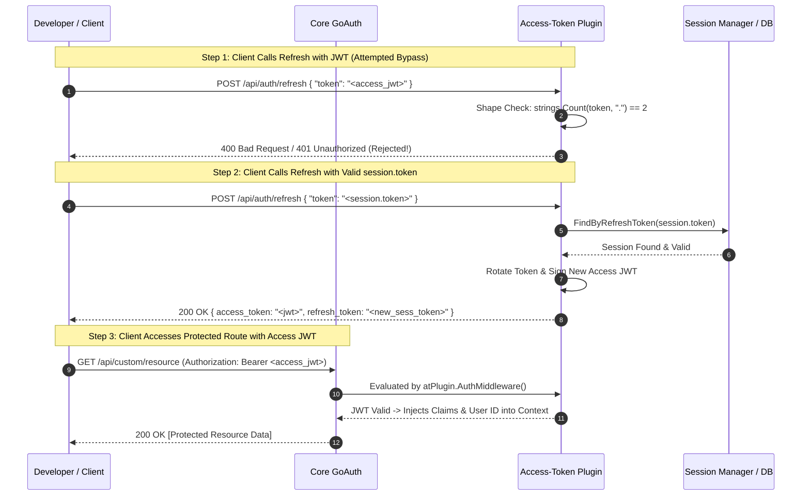

# Phase 5: Access Token Route Classification & Scoped Protection Plan

> **Document Location:** `_docs/phase5/02-access-token-route-protection-plan.md`  
> **Related Document:** [`_docs/phase5/01-token-resolution-and-middleware-flow.md`](file:///home/k/Documents/7proj/better-go-auth/goauth/_docs/phase5/01-token-resolution-and-middleware-flow.md)  
> **Goal:** Transition the `access-token` plugin from a blanket global middleware to an explicit, scoped architecture that enforces the **Route Classification and Protection Matrix**, specifically guaranteeing that refresh/lifecycle endpoints strictly require the `session.token` (Refresh Token) and reject Access Token JWTs.

---

## 1. Executive Summary & Problem Analysis

### Current Architecture
Currently, when the `access-token` plugin initializes via [`Plugin.Init()`](file:///home/k/Documents/7proj/better-go-auth/goauth/src/plugins/access-token/access_token.plugin.go#L244-L250), it executes:
```go
if ictx.Api != nil {
    ictx.Api.UseMiddleware(p.middleware)
    p.SetupHumaRoutes(ictx.Api, ictx.MiddleWare)
}
```

Because [`api.UseMiddleware`](file:///home/k/Documents/7proj/better-go-auth/goauth/src/plugins/access-token/access_token.plugin.go#L247) registers `p.middleware` as a **global Huma interceptor**, every single operation subsequently registered on that Huma API instance is evaluated by the access-token parser:
1. If any request contains `Authorization: Bearer <access_jwt>`, `p.middleware` validates the JWT signature, queries the `sid:` cache/database, sets `humaadapter.WithSession(stdCtx, sessWithUsr)`, and injects a session cookie into the request header.
2. When the request reaches downstream route middlewares (e.g. [`Resolver.Require()`](file:///home/k/Documents/7proj/better-go-auth/goauth/src/app/adapters/huma/session_middleware.go#L20-L40)), `Resolver` sees that `humaadapter.FromContext(ctx)` is already populated and admits the request.

### The Problem
* **No Route Boundaries:** Endpoints that should **only** be accessible by persistent session holders (e.g. `/api/auth/list-sessions`, `/api/auth/revoke-session`, `/api/auth/sign-out`) can inadvertently be accessed using a short-lived access JWT.
* **Self-Refreshing Access Tokens:** If an access token JWT is mistakenly treated as a session token on `/api/auth/refresh`, an access token could theoretically refresh itself, violating the fundamental security boundary between short-lived stateless authorization credentials and stateful persistent session credentials.
* **Bearer Plugin Conflicts:** Global interception causes `Authorization: Bearer` contention between opaque session tokens (handled by the [`bearer` plugin](file:///home/k/Documents/7proj/better-go-auth/goauth/src/plugins/bearer/bearer.plugin.go)) and 3-segment JWTs.

---

## 2. Target Route Classification and Protection Matrix

| Route Category | Typical Endpoints | Permitted Credential | Target Middleware Strategy | Rejection Behavior |
| :--- | :--- | :--- | :--- | :--- |
| **1. Public / Auth Entry** | `/api/auth/sign-in`, `/api/auth/sign-up`, `/api/auth/verify-email` | None (Public) | None | N/A |
| **2. Token Refresh** | `/api/auth/refresh` | **Refresh Token only** (`session.token`) | Dedicated handler check / `RequireRefreshTokenOnly` | Rejects any 3-segment JWT (`400 Bad Request` or `401 Unauthorized`) |
| **3. Session Lifecycle** | `/api/auth/sign-out`, `/api/auth/list-sessions`, `/api/auth/revoke-session` | **Session Token or Cookie** | Core [`AuthMiddleware`](file:///home/k/Documents/7proj/better-go-auth/goauth/src/common/middleware/middleware.go#L80-L127) or [`Resolver.Require()`](file:///home/k/Documents/7proj/better-go-auth/goauth/src/app/adapters/huma/session_middleware.go#L20-L40) | Rejects JWT access tokens (`401 Unauthorized`) |
| **4. Protected API Resources** | `/api/users/me`, `/api/organization/*`, custom client APIs | **Access JWT** or **Session Cookie** | Scoped [`atPlugin.AuthMiddleware()`](file:///home/k/Documents/7proj/better-go-auth/goauth/src/plugins/access-token/access_token.plugin.go#L267-L270) or opt-in global middleware | Rejects invalid/expired JWT and missing session |

---

## 3. Required Changes Breakdown

### Change 1: Make Global Middleware Registration Configurable / Opt-In

* **Target File:** [`src/plugins/access-token/config/config.go`](file:///home/k/Documents/7proj/better-go-auth/goauth/src/plugins/access-token/config/config.go)  
* **Target File:** [`src/plugins/access-token/access_token.plugin.go`](file:///home/k/Documents/7proj/better-go-auth/goauth/src/plugins/access-token/access_token.plugin.go)  
* **What to Change:**
  1. Add an `AutoRegisterMiddleware` boolean field (with functional option `WithAutoRegisterMiddleware(bool)`) to [`AccessTokenConfig`](file:///home/k/Documents/7proj/better-go-auth/goauth/src/plugins/access-token/config/config.go).
  2. In [`Plugin.Init()`](file:///home/k/Documents/7proj/better-go-auth/goauth/src/plugins/access-token/access_token.plugin.go#L244-L250), only invoke `ictx.Api.UseMiddleware(p.middleware)` if `p.config.AutoRegisterMiddleware` is explicitly set to `true`.
  3. By default (`AutoRegisterMiddleware: false`), the plugin exports its middleware via `p.Middleware()` and `p.AuthMiddleware()`, but does **not** inject it globally into all Huma API operations.
* **Reason:**
  Enables developers to attach `atPlugin.AuthMiddleware()` only to specific route groups or operations that expect access tokens, keeping Better Auth core endpoints (session management, sign-out, refresh) free of accidental JWT expansion.

---

### Change 2: Strictly Enforce Refresh-Token-Only Validation on `/api/auth/refresh`

* **Target File:** [`src/plugins/access-token/services/serv.session.go`](file:///home/k/Documents/7proj/better-go-auth/goauth/src/plugins/access-token/services/serv.session.go#L165-L189)  
* **Target File:** [`src/plugins/access-token/services/serv.auth.go`](file:///home/k/Documents/7proj/better-go-auth/goauth/src/plugins/access-token/services/serv.auth.go#L123-L157)  
* **What to Change:**
  1. In `serv.session.go` ([`FindByRefreshToken`](file:///home/k/Documents/7proj/better-go-auth/goauth/src/plugins/access-token/services/serv.session.go#L167)):
     ```go
     // Reject 3-segment JWT access tokens immediately
     if strings.Count(refreshToken, ".") == 2 {
         return nil, autherr.ErrInvalidToken
     }
     ```
  2. In `serv.auth.go` ([`ResetToken`](file:///home/k/Documents/7proj/better-go-auth/goauth/src/plugins/access-token/services/serv.auth.go#L124)):
     Verify that `inputs.Body.Token` does not conform to a JWT format before querying the session manager.
* **Reason:**
  A refresh token must be a persistent database-backed `session.token` (or signed cookie token). It must **never** be possible to submit a 15-minute access JWT to `/api/auth/refresh` to obtain new tokens.

---

### Change 3: Export Reusable `RequireRefreshTokenOnly` Guard Middleware

* **Target File:** [`src/plugins/access-token/access_token.plugin.go`](file:///home/k/Documents/7proj/better-go-auth/goauth/src/plugins/access-token/access_token.plugin.go)  
* **What to Change:**
  Add a dedicated helper method to `*Plugin`:
  ```go
  // RequireRefreshToken returns a Huma middleware that requires a valid session.token (Refresh Token)
  // and explicitly rejects Access Token JWTs.
  func (p *Plugin) RequireRefreshToken() func(ctx huma.Context, next func(huma.Context))
  ```
* **Reason:**
  Allows custom client endpoints (e.g., custom refresh mechanisms, mobile session handoffs, biometric re-auth) to declare that only a genuine refresh token is accepted.

---

### Change 4: Isolate Core Session Management Endpoints to Cookies / Session Tokens

* **Target File:** [`src/app/adapters/huma/session_middleware.go`](file:///home/k/Documents/7proj/better-go-auth/goauth/src/app/adapters/huma/session_middleware.go#L50-L75)  
* **Target File:** [`src/common/middleware/middleware.go`](file:///home/k/Documents/7proj/better-go-auth/goauth/src/common/middleware/middleware.go#L80-L127)  
* **What to Change:**
  With `AutoRegisterMiddleware: false`, routes using `d.Resolver.Require()` (such as `/api/auth/list-sessions` and `/api/auth/revoke-session`) will no longer receive a pre-populated context from global access token middleware.
  If an access JWT is sent to `/api/auth/list-sessions`, `Resolver.Resolve()` attempts to look up the JWT in `session.Manager.Get(ctx, tok)`, fails, and returns `401 Unauthorized`.
* **Reason:**
  Complies with the Better Auth specification where session inspection and revocation require standard session authentication.

---

### Change 5: Test Harness & Documentation Verification

* **Target Files:**
  * [`src/example/main.go`](file:///home/k/Documents/7proj/better-go-auth/goauth/src/example/main.go)
  * [`src/plugins/access-token/test/access_token_test.go`](file:///home/k/Documents/7proj/better-go-auth/goauth/src/plugins/access-token/test/access_token_test.go)
  * [`src/tests/helpers/setup.go`](file:///home/k/Documents/7proj/better-go-auth/goauth/src/tests/helpers/setup.go)
* **What to Change:**
  1. Add unit/integration tests confirming that `/api/auth/refresh` returns `400` or `401` when passed an access token JWT.
  2. Verify that protected business routes configured with `atPlugin.AuthMiddleware()` accept access token JWTs while routes configured with `auth.MiddlewareInt().Authenticate()` reject them.
  3. Ensure all tests (`go test ./...`) pass with 100% success.

---

## 4. Implementation Steps (Phased Execution)



### Phase A: Configuration & Default Decoupling
1. Add `AutoRegisterMiddleware bool` to [`AccessTokenConfig`](file:///home/k/Documents/7proj/better-go-auth/goauth/src/plugins/access-token/config/config.go).
2. Update [`Plugin.Init()`](file:///home/k/Documents/7proj/better-go-auth/goauth/src/plugins/access-token/access_token.plugin.go) to guard `ictx.Api.UseMiddleware` behind `p.config.AutoRegisterMiddleware`.

### Phase B: Refresh Token Invariant Enforcement
1. Add fast-fail check `strings.Count(refreshToken, ".") == 2` in [`FindByRefreshToken`](file:///home/k/Documents/7proj/better-go-auth/goauth/src/plugins/access-token/services/serv.session.go#L167).
2. Add explicit error handling for invalid token types in [`ResetToken`](file:///home/k/Documents/7proj/better-go-auth/goauth/src/plugins/access-token/services/serv.auth.go#L124).

### Phase C: Route Middleware Export & Test Suite Alignment
1. Provide `RequireRefreshToken()` on [`Plugin`](file:///home/k/Documents/7proj/better-go-auth/goauth/src/plugins/access-token/access_token.plugin.go).
2. In test suites (`setup.go`, `server.go`), configure `AutoRegisterMiddleware: true` where legacy global tests expect it, while adding new tests that validate selective route-level scoping.
3. Run `go test ./...` to guarantee 100% test passage.
