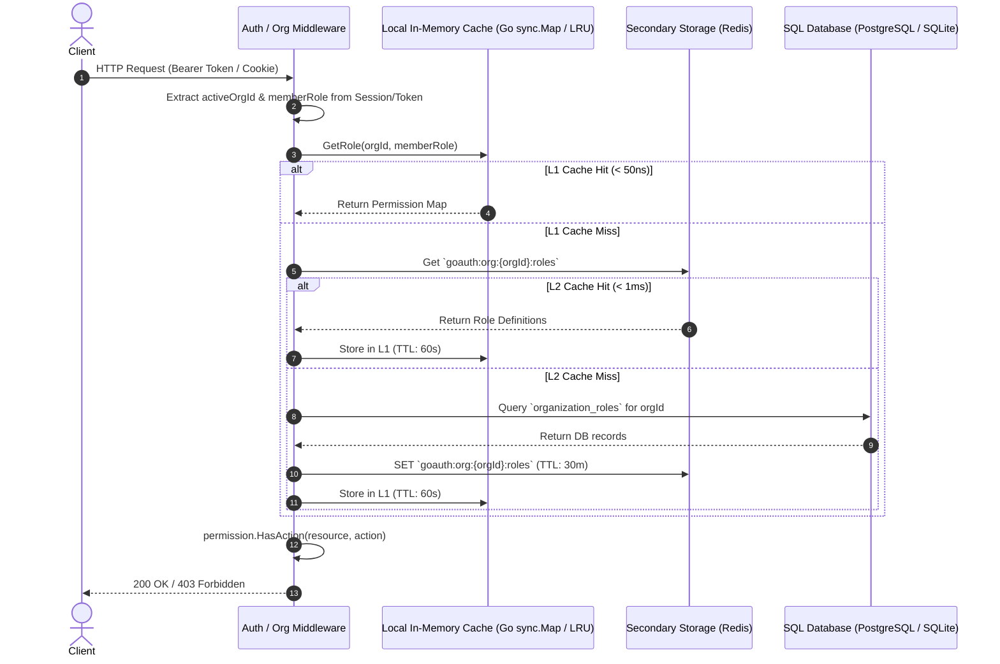

# Phase 6: Dynamic Role & Permission Caching Architecture Plan

## 1. Executive Summary & Verdict

### The Question
> *"Is it better to cache all the roles on secondary storage, or cache the role on the user's session, or inside the access token so that when checking for dynamic role we don't make a DB round trip?"*

### The Verdict: **Hybrid Role-Centric Caching on Secondary Storage (Option 3)**
The architectural best practice is **Option 3: Cache Organization Roles on Secondary Storage (with an L1 In-Memory read layer)**, while keeping **only the user's role identifier** (`role: "editor"`) on the Access Token and Session.

```
┌────────────────────────────────────────────────────────────────────────────────────────┐
│                                RECOMMENDED ARCHITECTURE                                │
├────────────────────────────────┬───────────────────────────────────────────────────────┤
│ Access Token / User Session    │ Holds ONLY: `activeOrgId` and `role` (e.g. "editor")  │
│ (User Identity Context)        │ Payload: ~30 bytes (Stateless, lightweight, small)     │
├────────────────────────────────┼───────────────────────────────────────────────────────┤
│ Secondary Storage (Redis / L2) │ Holds: `org:{orgId}:roles` (All role permission docs)  │
│ + L1 In-Memory Cache (sync/LRU)│ O(1) single-entry invalidation on role changes         │
└────────────────────────────────┴───────────────────────────────────────────────────────┘
```

---

## 2. In-Depth Comparison of the Three Approaches

### Approach A: Cache Dynamic Permissions in the Access Token (JWT Claims)
In this approach, the user's JWT contains the full dynamic permissions document:
```json
{
  "sub": "user_123",
  "org_id": "org_abc",
  "role": "project-manager",
  "permissions": {
    "project": ["create", "read", "update"],
    "billing": ["read", "export"],
    "servers": ["read", "restart"]
  }
}
```

#### Advantages
- **Zero Round Trips**: Verification occurs entirely in CPU memory via JWT signature validation.
- **Service Autonomy**: Downstream microservices can check permissions without reaching out to any database or cache.

#### Fatal Drawbacks & Why It Fails for Dynamic RBAC
1. **HTTP Header & Cookie Bloat**:
   - Dynamic permissions can grow large (20+ resources with multiple actions).
   - In web environments, cookies and HTTP headers have strict size thresholds (often 4KB - 8KB). A bloated JWT causes HTTP 431 (*Request Header Fields Too Large*) errors or cookie overflow.
2. **Revocation & Invalidation Lag**:
   - If an organization owner modifies the `project-manager` permissions or demotes the user, the user's JWT remains valid with elevated privileges until its expiration (15m – 1h).
   - Fixing this requires an immediate revocation blacklist lookup on every request, which completely negates the "zero round-trip" advantage.
3. **Organization Switching Penalty**:
   - When a user switches their active organization, the client must request and issue a brand-new token.

---

### Approach B: Cache Permissions on the User's Session
In this approach, dynamic permissions are stored within the user's session record in the database or session cache (`session:{sessionId}`):
```json
{
  "sessionId": "sess_xyz",
  "userId": "user_123",
  "activeOrgId": "org_abc",
  "role": "project-manager",
  "permissions": {
    "project": ["create", "read", "update"]
  }
}
```

#### Advantages
- Keeps HTTP headers and JWT sizes compact.
- Revocable when the user logs out or the session expires.

#### Critical Pitfalls
1. **Massive Data Duplication (N × M Storage Explosion)**:
   - If an organization has 5,000 members with the `member` role, the identical permission document is duplicated across 5,000 separate session entries.
2. **Invalidation Fan-Out Nightmare (The "Admin Edit" Problem)**:
   - When an organization owner updates the `member` role permissions, the server cannot simply invalidate a single cache key.
   - It must query all active sessions across the organization and update or purge each one. In high-traffic systems, this causes severe cache lock contention and DB spikes.
3. **Multi-Device Desynchronization**:
   - If a user has sessions active on mobile, desktop, and tablet, modifying user-level role assignments requires updating multiple session documents.

---

### Approach C: Cache Organization Roles on Secondary Storage (Recommended)
In this approach, the system separates **Who the user is** from **What the role is permitted to do**:
1. **User Identity** (Session or Token): Stores only `userId`, `activeOrgId`, and `role: "project-manager"`.
2. **Organization Roles** (Secondary Storage): Stores the role definitions for the organization under `org:{orgId}:roles`.

```
User Request
    │
    ├── 1. Read User Session / Token ───► activeOrgId: "org_abc", role: "project-manager"
    │                                     (Zero DB queries, lightweight)
    │
    └── 2. Check Permission ─────────────► Lookup `org:org_abc:roles` in L1 (Memory) / L2 (Redis)
                                          (Resolves in < 0.1ms; shared by ALL org members)
```

#### Key Advantages
1. **Minimal Memory Footprint (1:1 per Org Role)**:
   - A 10,000-user organization with 5 roles stores exactly **5 role entries** in cache, not 10,000 entries.
2. **Instant O(1) Invalidation**:
   - When an admin updates a role via `UpdateRole()`, only the single key `org:{orgId}:roles` is invalidated.
   - Every single member of the organization immediately reflects the updated permissions on their very next request—with zero stale windows.
3. **Effortless Organization Switching**:
   - Switching active organization only updates the user's `activeOrgId`. The role definition for the new organization is already warm in cache.
4. **L1 Local Memory Layer (Sub-Microsecond Latency)**:
   - By pairing Redis (L2) with a short-TTL or pub/sub-invalidated in-memory cache (L1), 99.9% of permission checks never leave process memory (< 50ns evaluation).

---

## 3. Comparison Matrix

| Dimension | Option A: Inside Access Token | Option B: Inside User Session | Option C: Roles on Secondary Storage (Recommended) |
| :--- | :--- | :--- | :--- |
| **Request Wire Size** | ❌ High (JWT bloat, header limits) | ✅ Low (only session ID in cookie) | ✅ Low (compact token / cookie) |
| **Cache Storage Efficiency** | ✅ None (client-side) | ❌ Poor (duplicated per session) | ✅ Optimal (stored once per org role) |
| **Invalidation Latency** | ❌ Stale until token expiry | ❌ Slow (fan-out over all active sessions) | ✅ **Instantaneous** ($O(1)$ key deletion) |
| **Org Context Switching** | ❌ Requires new JWT minting | ⚠️ Updates session payload | ✅ Instantaneous (read cached org role) |
| **Permission Check Speed** | ⚡ Instant (CPU signature) | ⚡ Fast (1 session read) | ⚡ **Ultra-Fast** (< 0.1ms L1/L2 read) |
| **Scalability with Team Size** | ⚠️ Degrades on complex roles | ❌ Degrades with active sessions | ✅ **Infinite scale** ($O(1)$ per role) |
| **Better-Auth Compatibility** | ⚠️ Deviates from better-auth spec | ⚠️ Deviates from standard session shape | ✅ **100% Native Alignment** |

---

## 4. Architectural Design: Two-Tiered (L1/L2) Role Caching

### 4.1 Storage Schema & Key Conventions

```
Secondary Storage (Redis / Memory):
┌────────────────────────────────────────────────────────────────────────────────┐
│ Key:   `goauth:org:{organizationId}:roles`                                     │
│ Type:  HASH or Stringified JSON Map                                            │
│ Value: {                                                                       │
│          "admin": { "permission": { "*": ["*"] } },                            │
│          "editor": { "permission": { "posts": ["create", "read", "update"] } },│
│          "viewer": { "permission": { "posts": ["read"] } }                     │
│        }                                                                       │
│ TTL:   30 minutes (with proactive cache-aside revalidation)                    │
└────────────────────────────────────────────────────────────────────────────────┘
```

### 4.2 Two-Tiered Read Flow



---

## 5. Cache Invalidation & Event Flow

To guarantee strict consistency across multiple running instances, role mutations must invalidate the cached role document:

```mermaid
flowchart TD
    A[Admin calls CreateRole / UpdateRole / DeleteRole] --> B[Write to SQL Database]
    B --> C{Success?}
    C -- No --> D[Return Error]
    C -- Yes --> E[Invalidate L2 Cache: DEL goauth:org:{orgId}:roles]
    E --> F[Publish Redis Pub/Sub: 'org:roles:invalidate' with orgId]
    F --> G[All server replicas purge local L1 memory for orgId]
    G --> H[Return Success to Client]
```

### Affected Operations
1. **`CreateRole(orgID, role, permission)`**:
   - Invalidate: `DEL goauth:org:{orgID}:roles`
2. **`UpdateRole(orgID, role, permission)`**:
   - Invalidate: `DEL goauth:org:{orgID}:roles`
3. **`DeleteRole(orgID, role)`**:
   - Invalidate: `DEL goauth:org:{orgID}:roles`
4. **`DeleteOrganization(orgID)`**:
   - Invalidate: `DEL goauth:org:{orgID}:roles`

---

## 6. Implementation Plan for `better-go-auth`

### Step 1: Add Role Caching Interface to Repository / Service Layer
Extend `IOrganizationRoleRepo` or create a caching decorator `CachedOrganizationRoleRepo`:
```go
type CachedOrganizationRoleRepo struct {
    underlying IOrganizationRoleRepo
    storage    sec_storage.SecondaryStorage
    l1Cache    *sync.Map // or fast lru.Cache
    l1TTL      time.Duration
}
```

### Step 2: Key Generation & Serialization
```go
func orgRolesCacheKey(orgID string) string {
    return fmt.Sprintf("goauth:org:%s:roles", orgID)
}
```
Store all roles for an organization in a single cache entry:
```go
type OrgRolesCacheDocument map[string]models.Permission
```
*Why all roles in one entry?*
- Organizations rarely have more than 5–15 roles.
- A single batch read `Get(orgRolesCacheKey(orgID))` fetches all roles in one round trip.
- Checking any role in that organization during subsequent requests hits L1 memory directly.

### Step 3: Implement `HasPermission` with L1/L2 Bypass
Update [`serv.team.go`](file:///home/k/Documents/7proj/better-go-auth/goauth/src/plugins/org/services/serv.team.go):
```go
func (s *OrgService) HasPermission(ctx context.Context, orgID, role, resource, action string) (bool, error) {
    // 1. Static fallback checks (Owner, Admin, Member)
    if !s.DynamicAccessControlEnabled() {
        return s.evaluateStaticRole(role, resource, action)
    }

    // 2. Fetch role from L1/L2 cache
    perm, err := s.getRolePermissionCached(ctx, orgID, role)
    if err != nil {
        // Fallback to direct DB query on cache error
        return s.hasPermissionFallbackDB(ctx, orgID, role, resource, action)
    }

    // 3. In-memory wildcard action check
    return perm.HasAction(resource, action), nil
}
```

### Step 4: Proactive Invalidation on Mutation
In [`serv.team.go`](file:///home/k/Documents/7proj/better-go-auth/goauth/src/plugins/org/services/serv.team.go):
```go
func (s *OrgService) UpdateRole(...) (*models.OrganizationRole, error) {
    role, err := s.orgRoleRepo.UpdateRole(ctx, orgID, roleName, parsedPerm)
    if err != nil {
        return nil, err
    }
    // Proactively purge cached org roles
    _ = s.invalidateOrgRolesCache(ctx, orgID)
    return role, nil
}
```

---

## 7. Summary & Recommendations

1. **Do NOT put dynamic permission documents in the JWT**:
   - It bloats requests, risks HTTP 431 errors, and cannot be revoked without token blacklisting.
2. **Do NOT put dynamic permission documents in the User Session**:
   - It leads to $N \times M$ cache duplication and requires complex fan-out invalidation across every active session when an admin updates a role.
3. **DO cache Organization Roles on Secondary Storage with an L1 memory buffer**:
   - It is $O(1)$ in storage per organization.
   - It provides instantaneous invalidation on role update.
   - It yields sub-microsecond permission check latency for all users in the organization.
